# RoboMasterClient 技术与操作手册

适用版本：客户端 2.0.0，扩展 SDK 1.12.0。文档核对日期：2026-10-22。

RoboMasterClient 使用 Qt Quick / QML 呈现比赛视野、机器人状态和操作面板，由 C++ 负责 MQTT 通信、UDP 视频解码、协议校验与输入管理。当前官方消息映射以 2026 赛季协议为准；2027 赛季规则资料与场地展示单独管理，尚未完成的通信映射不作为已支持能力。

本手册先说明操作入口和快捷键，再说明数据链路、可选扩展与开发接口。所有图片均来自当前程序运行画面；示例数值用于说明显示与交互，不代表比赛现场记录。动图为连续操作录制的抽帧版本，不用于衡量帧率或端到端延迟。

| 阅读目的 | 入口 |
| --- | --- |
| 首次接入、修改 MQTT / UDP 和身份 | [连接与启动](#startup) |
| 查按键、打开面板、了解是否发送请求 | [快捷键与输入](#shortcuts) |
| 阅读顶部状态、查看机器人与增益 | [主界面与状态](#visual) |
| 在小地图、二维或三维地图发送信号 | [地图与标注](#maps) |
| 配置整机识别、吊射辅助、共享和播报 | [扩展操作](#management) |
| 了解架构、视频、协议和插件开发 | [架构](#architecture) · [视频](#video) · [SDK](#authoring) |
| 查询字段、手册页面或故障 | [37 类结构 / 175 个字段](#fields) · [官方页面对应](#pages) · [故障排查](#troubleshooting) |

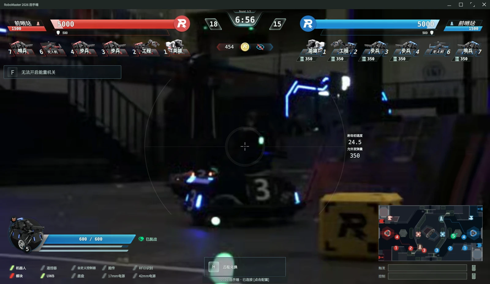

图 1：当前主界面。顶部集中显示双方状态与比赛信息，中央保留视频视野，详细操作通过面板展开。

<a id="startup"></a>
## 1. 连接、身份与首次使用

### 1.1 接入步骤

1. 按 **Ctrl+Shift+L** 或 **Ctrl+Alt+O**，直接打开“连接与登录”。这两个入口均用于修改当前连接，不经过启动配置草稿页。
2. 填写官方选手端消息导出的 MQTT 地址与端口，选择红蓝方和机器人身份。红方编号为 1–9，蓝方为 101–109，必须与消息导出身份对应。
3. 填写 UDP 接收地址、端口、编码和来源限制。接收地址是客户端网卡地址；来源限制才是推流方地址。
4. 点击“连接所选身份与地址”或按 Enter，应用当前 MQTT / UDP 参数。核对实际连接状态、机器人身份、字段更新时间及视频画面。
5. 需要向机器人上传原始键鼠输入时，再用 **Ctrl+Shift+I** 开启捕获。界面导航快捷键不以捕获开启为前提。

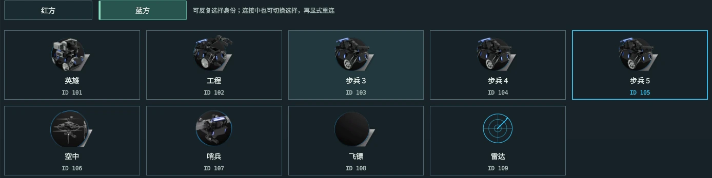

图 2：身份选择区域。T 切换阵营，数字 1–9 只改变选中项；按 Enter 才应用连接。

### 1.2 MQTT 与 UDP 参数的区别

| 参数 | 填写含义 | 调整后的行为 |
| --- | --- | --- |
| MQTT 目标地址、端口 | 官方选手端导出的消息服务；2026 资料参考值为 `192.168.12.1:3333`，以赛事配置为准 | 通过连接或重新连接应用 |
| UDP 监听地址 | 客户端用于收包的接口；`0.0.0.0` 表示监听全部 IPv4 网卡 | 应用 UDP 后重新建立接收 |
| UDP 监听端口 | 与发送方的目标端口一致；程序默认 `3334` | 默认值不代表所有赛事统一端口 |
| UDP 来源地址、端口 | 限制允许的视频发送方；来源地址留空时锁定首个有效来源 | 多个发送方并存时应明确指定，切换时清除旧锁定 |
| 组播地址 | 仅组播流需要填写 | 普通单播留空 |
| 编码 | 与实际 H.264 / HEVC 码流一致 | 编码错误可能收包正常但无法形成画面 |

MQTT 状态和 UDP 状态分别显示，消息已连接不代表视频已到达，视频正常也不代表控制链路就绪。连接页面的 Ctrl+R 使用当前 MQTT 与 UDP 选项重新连接；Ctrl+Alt+V 仅应用 UDP，不更改 MQTT。

连接参数和机器人身份可在比赛进行中编辑，并由操作员明确应用。切换身份、重连和连接失败均不应改变窗口的全屏状态。F11 专门负责窗口模式切换。发生断连时，可在该页面检查目标和身份后手动重连；本手册不约定固定重连周期。

<a id="shortcuts"></a>
## 2. 快捷键与输入

### 2.1 先掌握这些入口

| 按键 | 打开什么 / 有什么用 | 触发方式 |
| --- | --- | --- |
| **P** | 设置：性能、图传、音效与界面选项 | HUD 路由可用时切换显示 |
| **H** | 按角色打开兑换、工程装配或空中支援 | 英雄 / 步兵需符合远程兑换资格；再次按下关闭 |
| **Tab** | 双方机器人状态表 | 按住查看，松开关闭 |
| **F12** | 操作帮助 | 按住查看，松开关闭 |
| **M** | 大地图 | 切换三维地图或二维回退；打开地图本身不发送标记 |
| **F11** | 全屏 / 原窗口模式 | 单次切换 |
| **Ctrl+Shift+L** | MQTT、UDP 与机器人身份 | 比赛中也可打开并修改 |
| **Ctrl+Shift+I** | 原始键鼠捕获 / 释放 | 持续开关；与打开普通面板不同 |
| **Ctrl+Shift+K** | 快捷键管理 | 搜索动作、检查冲突、修改并保存 |
| **Ctrl+Shift+E** | 服务与插件 | 查看能力、启停可选服务、检查依赖和错误 |

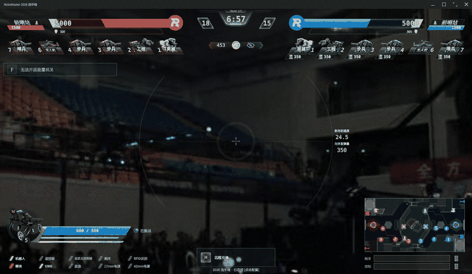

图 3：依次按住 F12、按住 Tab，再打开快捷键管理。前两者松开即收起，快捷键管理保持打开。

### 2.2 生效范围与发送边界

快捷键按“当前窗口、焦点、面板、角色与状态”共同路由。下表中的 `always` 只是客户端内部作用域：窗口仍须处于活动状态；它不是操作系统全局热键。正在编辑输入框或展开选择控件时，普通操作快捷键让位于编辑，避免输入字母、数字时误触动作。捕获退出组合键保留可达。

| 操作类别 | 示例 | 网络行为 |
| --- | --- | --- |
| 打开 / 查看 | P、Tab、协议视图、插件管理 | 打开本身不提交机器人动作；若暂停捕获，可能产生必要的中性释放输入 |
| 只改变选择 | 身份数字键、兑换 Ctrl+1、哨兵 Ctrl+1、工程难度键 | 需另行应用或确认 |
| 明确请求 | 空中支援 Ctrl+1 / 2 / 3、飞镖 J、合资格时飞镖 L | 通过角色、权限、数据时效及状态校验后发送 |
| 长按请求 | 英雄 K / L、步兵 F | 保持 1.2 秒且资格有效才提交；提前松开或失焦取消 |
| 地图滑动信号 | 长按 250 毫秒后向右滑选 | 在有效扇区松开时提交；普通点击不提交 |
| 原始键鼠输入 | 开启捕获后的键盘与相对鼠标输入 | 走专用 `KeyboardMouseControl` 管线 |

同一个按键可以在不同面板表示不同动作。例如 Y 在兑换面板用于确认，在战亡界面可能申请免费复活；Ctrl+1 在兑换与哨兵面板只是选择，在空中支援面板则可能直接请求。应以当前面板提示为准。

### 2.3 通用窗口与面板完整表

以下列出默认绑定及动作标识，便于与快捷键管理对应。除固定键外，修改后的绑定优先于默认值。表中的“查看”不等于服务已启动，依赖缺失时会显示不可用或错误状态。

| 默认按键 | 动作标识 | 功能与行为 | 范围 / 角色 |
| --- | --- | --- | --- |
| `P` | `settings` | 设置：打开／关闭设置 | hud |
| `H` | `exchange` | 兑换 / 工程 / 空中支援：依角色和资格打开；再次按下关闭，不直接发送兑换或支援请求 | hud；1/2/3/4/5/6 号 |
| `Tab` | `status` | 机器人状态：按住查看，松开关闭；面板库打开可固定 | hud；固定 |
| <code>&#96;</code>（反引号） | `injury` | 伤害面板与模块状态：按住查看，松开收起 | hud |
| `F12` | `help` | 帮助提示：按住查看常用操作说明，松开关闭 | hud；固定 |
| `Ctrl+Shift+K` | `shortcutPanel` | 快捷键管理：查看、搜索和修改按键 | always |
| `F11` | `fullscreen` | 全屏：切换全屏，恢复之前窗口状态 | always；固定 |
| `Ctrl+Shift+I` | `capture` | 捕获 / 释放键鼠：持续切换原始输入捕获；退出或暂停时可能发送中性释放状态 | always |
| `Ctrl+Shift+U` | `layout` | HUD与面板库：隐藏、恢复、重新添加界面 | always |
| `Ctrl+Shift+L` | `login` | MQTT / UDP 连接与身份：比赛中可改连接地址、图传参数和机器人身份；手动应用生效 | always |
| `Ctrl+Shift+R` | `role` | 角色面板：打开当前机器人的专用操作界面 | hud |
| `M` | `map` | 大地图：切换可选三维地图或二维回退；标注使用 250 毫秒长按与向右滑选 | always |
| `Ctrl+Shift+P` | `protocol` | 协议字段：查看消息和字段状态；可编辑获准的上行消息，发送需明确操作 | always |
| `Ctrl+Shift+B` | `bytes` | 自定义数据：打开字节编辑，不自动发送 | always |
| `Ctrl+Shift+F9` | `situation` | 战场态势：打开可选态势窗口，只读采集与队内共享 | always |
| `Ctrl+Shift+E` | `services` | 服务与插件：查看已加载插件和连接状态 | always |
| `Ctrl+Alt+C` | `controlSetup` | 操作权限与参数：配置命令参数映射、飞镖权限和工程上下文；保存不发送机器人动作 | always |
| `Ctrl+Shift+A` | `decision` | 战术建议：查看建议与配置；打开、保存均不自动执行机器人动作 | always |
| `Ctrl+Shift+V` | `speech` | 语音播报：打开语音设置与当前状态 | always |
| `Ctrl+Shift+T` | `aggregation` | 队伍数据汇总：查看可选共享插件与汇总状态 | always |
| `Ctrl+Alt+T` | `team` | 队伍连接配置：配置可信节点和共享范围 | always |
| `Ctrl+Alt+S` | `sources` | 数据源配置：配置官方导出、传感器与视觉数据适配器 | always |
| `Ctrl+Alt+M` | `provider` | 建议服务连接：配置建议服务的连接参数和访问凭据引用 | always |
| `Ctrl+Alt+O` | `startup` | 连接与图传：直接修改本次连接、UDP与机器人身份 | always |
| `Ctrl+Alt+B` | `bridge` | 外部画面接口：查看外部渲染桥接，不启动UE | always |
| `Ctrl+Shift+F` | `buffs` | 增益详情：查看有来源的增益记录 | always |
| `Ctrl+Shift+J` | `dart` | 飞镖操作：打开飞镖云台手面板；目标切换、闸门选择和发射的发送规则不同 | always |

“操作权限与参数”用于命令映射和业务上下文；鼠标输入等普通设置从 P 进入。“外部画面接口”只查看桥接状态，不启动外部渲染引擎。“语音播报”打开设置与状态，不等同于向比赛语音频道发送声音，当前也没有统一的静音快捷键。

### 2.4 连接页面快捷键

这些动作仅在连接页面处于活动状态且没有文本编辑冲突时生效。身份键只修改选择，避免浏览身份时立即重建连接。

| 默认按键 | 动作标识 | 功能与行为 | 范围 / 角色 |
| --- | --- | --- | --- |
| `Return` | `loginConnect` | 登录：连接所选身份：显式应用当前MQTT／UDP参数 | login |
| `Ctrl+R` | `loginReconnect` | 连接：重新连接：用当前 MQTT 与 UDP 选项重新连接 | login |
| `Ctrl+Alt+V` | `loginVideo` | 登录：应用UDP：独立重建图传接收，不改变MQTT | login |
| `T` | `loginTeam` | 登录：切换红蓝方：只切换选择，不自动连接 | login |
| `1` | `loginRobot1` | 登录：选择1号机器人：只切换选择，不自动连接 | login |
| `2` | `loginRobot2` | 登录：选择2号机器人：只切换选择，不自动连接 | login |
| `3` | `loginRobot3` | 登录：选择3号机器人：只切换选择，不自动连接 | login |
| `4` | `loginRobot4` | 登录：选择4号机器人：只切换选择，不自动连接 | login |
| `5` | `loginRobot5` | 登录：选择5号机器人：只切换选择，不自动连接 | login |
| `6` | `loginRobot6` | 登录：选择6号机器人：只切换选择，不自动连接 | login |
| `7` | `loginRobot7` | 登录：选择7号机器人：只切换选择，不自动连接 | login |
| `8` | `loginRobot8` | 登录：选择8号机器人：只切换选择，不自动连接 | login |
| `9` | `loginRobot9` | 登录：选择9号机器人：只切换选择，不自动连接 | login |

### 2.5 角色、兑换与复活快捷键

角色编号按阵营对应使用：1 英雄，2 工程，3–5 步兵，6 空中，7 哨兵，8 飞镖，9 雷达；蓝方加 100。下列角色条件以当前已应用的身份为准。

#### 英雄与步兵

英雄 I 和步兵 O 打开对应口径的补弹页面，不直接兑换。英雄部署和能量机关请求采用长按确认；提示不可用时，应先查看资格和数据更新时间，不反复触发发送。

| 默认按键 | 动作标识 | 功能与行为 | 范围 / 角色 |
| --- | --- | --- | --- |
| `I` | `ammo42` | 42mm补弹：打开兑换页；选择、数量与确认分开 | hud；1 号 |
| `O` | `ammo17` | 17mm补弹：打开兑换页；不直接发送兑换 | hud；3/4/5 号 |
| `K` | `heroEnter` | 进入部署：保持1.2秒，松开／失焦取消 | hero；1 号 |
| `L` | `heroExit` | 退出部署：保持1.2秒，松开／失焦取消 | hero；1 号 |
| `F` | `runeHold` | 开启能量机关：保持1.2秒，资格有效才提交 | rune；3/4/5 号 |

#### 兑换面板

Ctrl+1 / 2 / 3 只选当前页项目；Y 校验项目和数量后提交。Enter 的含义随报价、选择和确认状态变化，不能理解为每按一次必发一条兑换命令。N 撤销选择。

| 默认按键 | 动作标识 | 功能与行为 | 范围 / 角色 |
| --- | --- | --- | --- |
| `Ctrl+1` | `exchange1` | 兑换：选择第1项：只选择当前页项目 | exchange |
| `Ctrl+2` | `exchange2` | 兑换：选择第2项：只选择当前页项目 | exchange |
| `Ctrl+3` | `exchange3` | 兑换：选择第3项：只选择当前页项目 | exchange |
| `Y` | `exchangeConfirm` | 兑换：确认：校验当前项目和数量后提交 | exchange |
| `Return` | `exchangeEnter` | 兑换：Enter：按页面状态报价、选择或确认；主键盘和数字键盘 Enter 均可 | exchange |
| `N` | `exchangeCancel` | 兑换：撤销选择：不发送命令 | exchange |

#### 工程装配

H 打开工程面板，1–4 选择装配难度，Enter 请求开始。Y 确认装配时依赖当前任务上下文；Ctrl+Y 只记录人工确认的本轮难度，不发送装配动作。L 在装配中可能请求退出，在完成结果页则返回选择。

| 默认按键 | 动作标识 | 功能与行为 | 范围 / 角色 |
| --- | --- | --- | --- |
| `Return` | `engineerStart` | 工程：开始装配：选择页；按当前难度请求 | engineer；2 号 |
| `Y` | `engineerConfirm` | 工程：装配确认：状态页；依赖宿主确认的难度 | engineer；2 号 |
| `Ctrl+Y` | `engineerContext` | 工程：确认本轮难度：状态页；记录人工选择的参数，不发送装配命令 | engineer；2 号 |
| `L` | `engineerPage` | 工程：退出装配 / 返回选择：装配期间可能发送退出请求；结果页返回难度选择 | engineer；2 号 |
| `1` | `engineerDifficulty1` | 工程：选择1级：只选择装配难度，Enter另行确认 | engineer；2 号 |
| `2` | `engineerDifficulty2` | 工程：选择2级：只选择装配难度，Enter另行确认 | engineer；2 号 |
| `3` | `engineerDifficulty3` | 工程：选择3级：只选择装配难度，Enter另行确认 | engineer；2 号 |
| `4` | `engineerDifficulty4` | 工程：选择4级：只选择装配难度，Enter另行确认 | engineer；2 号 |

#### 空中支援

H 打开支援面板。这里的 Ctrl+1 / 2 / 3 是明确的支援或解除反制请求，资格与数据新鲜度有效时直接提交，与兑换面板的选择键不同。N 请求结束当前支援。

| 默认按键 | 动作标识 | 功能与行为 | 范围 / 角色 |
| --- | --- | --- | --- |
| `N` | `airEnd` | 结束空中支援：请求结束当前空中支援 | hud；6 号 |
| `Ctrl+1` | `airFree` | 支援：免费呼叫：提交明确支援请求 | air；6 号 |
| `Ctrl+2` | `airPaid` | 支援：付费呼叫：提交明确支援请求 | air；6 号 |
| `Ctrl+3` | `airCounter` | 支援：解除反制：可解除状态下提交付费解除请求 | air；6 号 |
| `N` | `airCancel` | 支援：结束：提交明确支援请求 | air；6 号 |

#### 哨兵

在哨兵专用面板中，Ctrl+1–6 选择当前组项目，Y 才确认。L 切换姿态 / 补给与复活分组并清除旧选择；N 撤销。选择项目的含义随服务器允许的操作更新。

| 默认按键 | 动作标识 | 功能与行为 | 范围 / 角色 |
| --- | --- | --- | --- |
| `Ctrl+1` | `sentry1` | 哨兵：选择第1项：当前页可用项目；Y确认 | sentry；7 号 |
| `Ctrl+2` | `sentry2` | 哨兵：选择第2项：当前页可用项目；Y确认 | sentry；7 号 |
| `Ctrl+3` | `sentry3` | 哨兵：选择第3项：当前页可用项目；Y确认 | sentry；7 号 |
| `Ctrl+4` | `sentry4` | 哨兵：选择第4项：当前页可用项目；Y确认 | sentry；7 号 |
| `Ctrl+5` | `sentry5` | 哨兵：选择第5项：当前页可用项目；Y确认 | sentry；7 号 |
| `Ctrl+6` | `sentry6` | 哨兵：选择第6项：当前页可用项目；Y确认 | sentry；7 号 |
| `L` | `sentryPage` | 哨兵：切换分组：姿态／补给与复活；清除旧选择 | sentry；7 号 |
| `Y` | `sentryConfirm` | 哨兵：确认：仅确认当前合资格项目 | sentry；7 号 |
| `N` | `sentryCancel` | 哨兵：撤销选择：不发送命令 | sentry；7 号 |

#### 飞镖

Ctrl+Shift+J 打开面板。**J 在允许切换目标时直接发送目标请求**；F / C 先选择开闸 / 关闸，再按 Y 确认；L 在闸门已开启且权限、状态均有效时请求发射。N 撤销待确认选择。选择目标和发射均受独立云台手权限约束。

| 默认按键 | 动作标识 | 功能与行为 | 范围 / 角色 |
| --- | --- | --- | --- |
| `J` | `dartTarget` | 飞镖：下一个目标：权限、状态及目标有效时直接发送切换目标请求；不等待 Y | dart |
| `F` | `dartOpen` | 飞镖：选择开闸：Y另行确认 | dart |
| `C` | `dartClose` | 飞镖：选择关闸：Y另行确认 | dart |
| `L` | `dartLaunch` | 飞镖：发射：闸门开启且资格允许时发射 | dart |
| `Y` | `dartConfirm` | 飞镖：确认闸门选择：确认 F / C 选择，仍须通过状态与权限校验 | dart |
| `N` | `dartCancel` | 飞镖：撤销选择：不发送命令 | dart |

#### 战亡与复活

F1 请求付费立即复活前会检查资格、费用与金币。Y 只在免费复活读条完成且服务器允许时请求；读条完成本身不代表机器人已复活。

| 默认按键 | 动作标识 | 功能与行为 | 范围 / 角色 |
| --- | --- | --- | --- |
| `F1` | `respawnPaid` | 兑换立即复活：战亡时核对资格、费用和金币后请求 | respawn |
| `Y` | `respawnFree` | 免费复活：复活读条完成且服务器允许时请求 | respawn |

### 2.6 修改按键与捕获管理

按 Ctrl+Shift+K 打开快捷键管理，检索动作，修改绑定，通过冲突检查后保存。Tab、F11、F12 是固定键。捕获退出键必须保留 Ctrl+Shift 或 Ctrl+Alt 组合，不能禁用；机器人原始键位与界面快捷键分别管理。

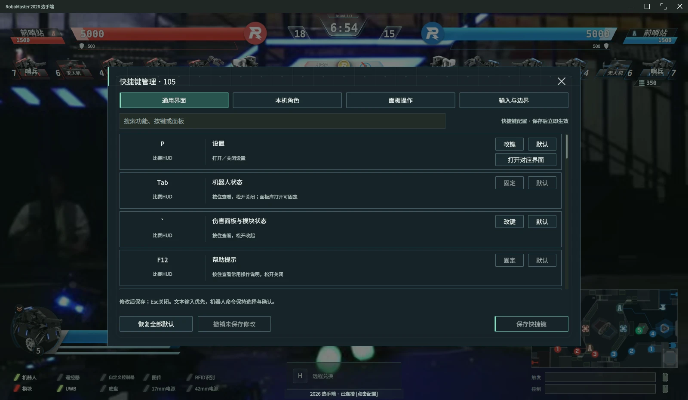

图 4：默认按键、动作说明和绑定管理。保存界面快捷键不会重排原始机器人键位位图。

Ctrl+Shift+I 控制持续捕获意图。操作面板打开时，程序可以暂停捕获，让鼠标用于编辑与点击；关闭面板后恢复原有捕获意图。Esc 从 HUD 打开设置，只是临时进入界面操作，不等于永久关闭捕获。需要停止原始输入上行时，使用捕获退出组合键，并检查捕获状态提示。

窗口失焦、捕获暂停或退出时，输入管线清空按键与鼠标按下状态，必要时发送中性释放，避免机器人端保留按下状态。未捕获的普通界面按键不作为原始键鼠上传；面板中的明确业务请求仍可通过对应动作入口发送。

`KeyboardMouseControl.keyboard_value` 的低 16 位依次对应：

| 位号 | 0 | 1 | 2 | 3 | 4 | 5 | 6 | 7 | 8 | 9 | 10 | 11 | 12 | 13 | 14 | 15 |
| --- | --- | --- | --- | --- | --- | --- | --- | --- | --- | --- | --- | --- | --- | --- | --- | --- |
| 键 | W | S | A | D | Shift | Ctrl | Q | E | R | F | G | Z | X | C | V | B |

鼠标字段上传相对移动量、滚轮和按钮状态。具体底盘、云台或射击行为由机器人程序解释；客户端不保证相对鼠标量已经转换为云台角速度。

快捷键注册与路由分别见 [OperatorShortcutRegistry.js](../qml/components/OperatorShortcutRegistry.js)、[OperatorUiShortcuts.qml](../qml/components/OperatorUiShortcuts.qml)、[OperatorActionShortcut.qml](../qml/components/OperatorActionShortcut.qml)。业务发送校验见 [OperatorActions.cpp](../app/src/OperatorActions.cpp)，原始输入边界见 [InputController.cpp](../input/src/InputController.cpp)。

<a id="visual"></a>
## 3. 主界面、状态与显示规则

### 3.1 顶部信息与视野

顶部红左蓝右，集中显示基地、前哨站、比分、计时和机器人队列。基地血量条中线与比分中线对齐；前哨站由标题、血量和独立防御增益槽组成，增益出现时使用预留空间，避免撑大前哨站血量条。

机器人血量在原有槽内分格显示，并结合等级与血量计算红色小块。等级支持 1–10。文字、图标和贴图应落在各自槽内，未知值不按零血量处理。窗口增大时，顶部和底部区域向边缘让出中央视频空间；面板使用半透明底色，但关键文字与选中状态仍需保持清晰。

### 3.2 状态、增益与错误

按住 Tab 查看双方机器人状态，按住反引号查看伤害和模块，Ctrl+Shift+F 查看增益详情。增益应保留来源和适用对象，不将同名效果无条件相加。消息通知、判罚和业务结果与当前状态分开显示，发送成功也不能替代服务器回执。

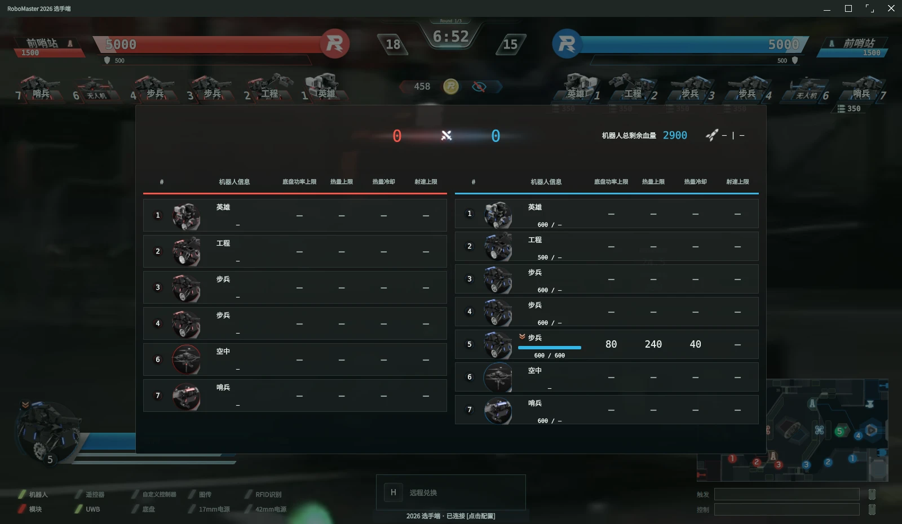

图 5：Tab 状态表。该表展示机器人信息，不是系统资源监视器。

| 数据状态 | 阅读方式 |
| --- | --- |
| 已收到且有效 | 显示数值与必要单位 |
| 字段缺失 / 尚未收到 | 保持未知，不替换成 0、首个枚举或成功状态 |
| 数据过期 | 标记陈旧，涉及资格的操作重新校验或拒绝 |
| 通信断开 | 显示链路状态；保留的历史值不代表仍实时有效 |
| 请求待回执 / 已拒绝 | 查看业务提示与实际状态回传，不凭按钮变化判断成功 |

### 3.3 布局与动效

P 打开性能、图传和界面设置；Ctrl+Shift+U 打开 HUD 布局与面板库，可隐藏、恢复或重新添加部件。减少动态效果选项用于降低非必要演出，地图状态与关键数值仍保持更新。全屏切换由 F11 控制，多屏使用可选独立态势窗口。

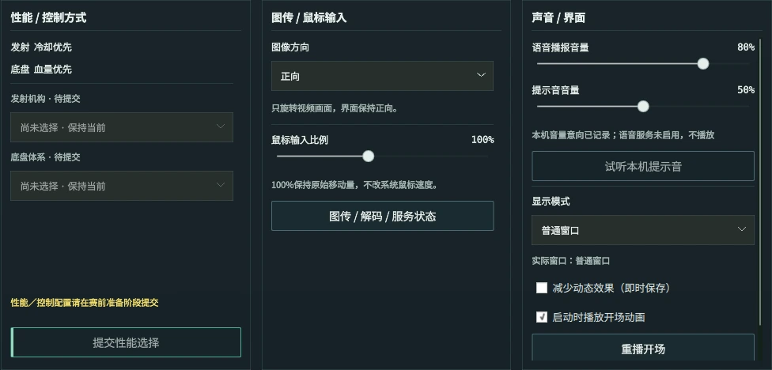

图 6：设置中的性能、图传与界面区域。连接和身份参数由专用连接面板应用。

<a id="maps"></a>
## 4. 地图、信号与来源区分

### 4.1 小地图、二维大地图与三维地图

主界面小地图用于快速查看战场信息。M 打开大地图；三维扩展可用时显示三维场地，扩展缺失或不可用时回退二维。三维视图左键拖动旋转，右键拖动平移，滚轮缩放。

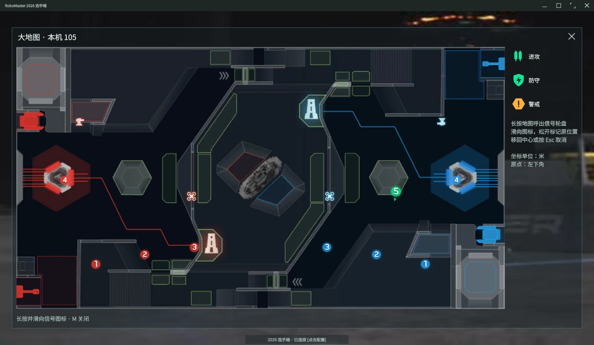

图 7：二维地图及状态信息。官方位置、人工标注与视觉估计使用各自显示语义。

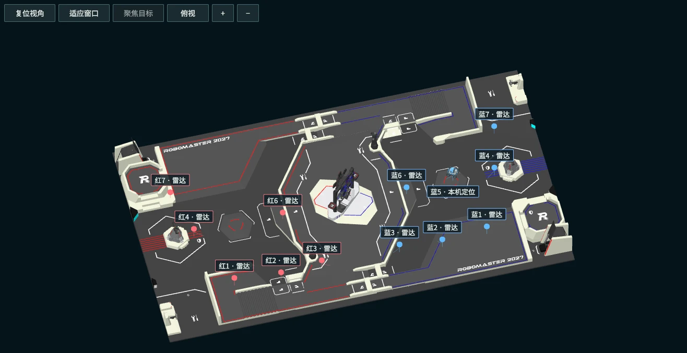

图 8：当前三维场地展示区域。三维几何采用 2027 场地资源；现有坐标适配不等于完成了 2027 实地标定。

### 4.2 长按滑动标注

在小地图、二维大地图或三维地图可标注的场地点长按 **250 毫秒**，向右展开进攻、防守、警戒扇形。保持按下并滑到对应扇区，松开后在最初长按位置提交信号。滑回中心或按 Esc 取消；普通点击不发送。当前交互不使用 A / B / I 预选后点击放置的模式。

二维地图长按有效的官方敌方雷达图标时，可使用敌方编号语义；普通地面位置使用坐标语义。两者对应 `MapClickCmd` 的不同类型，不把“敌方编号”与“坐标标注”同时当作同一请求的有效载荷。发送对象和范围仍由当前身份、权限与策略决定，不保证广播到所有客户端。

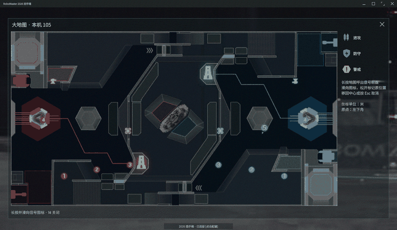

图 9：长按、滑选、松开提交的连续录制。扇形围绕最初按下位置展开。

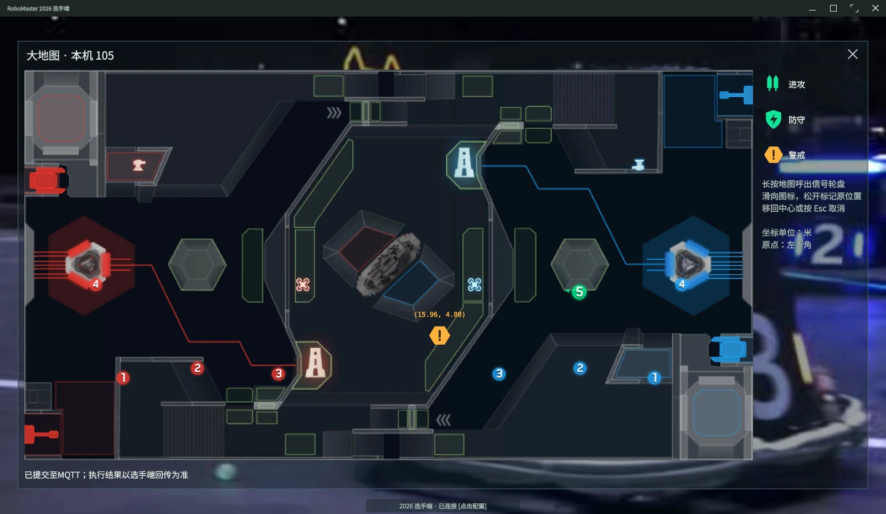

图 10：标注显示结果。提交与下行显示是两个环节，应以回传状态核对实际结果。

### 4.3 官方位置与估计位置

| 来源 | 显示含义 | 主要限制 |
| --- | --- | --- |
| 官方机器人 / 雷达消息 | 按消息映射显示位置、编号或路径 | 仍需检查接收时间、有效期与参考系 |
| 视觉检测框 | 某一相机帧中的目标候选 | 未必有阵营、编号或世界坐标；不能当作确定敌方位置 |
| 近似地面投影 | 利用相机参数和同期位姿计算的估计 | 显示估计性质、来源与误差范围；遮挡、坡面和时延会引入偏差 |
| 多源融合 | 多份兼容证据得到的估计或冲突记录 | 冲突不强行合并为确定坐标，内部评分不是标定后的概率 |
| 人工标注 | 操作员发出的战术信号 | 不进入机器人位置融合 |

视觉估计可在主界面小地图显示，但须与官方雷达和位置样式区分。来自队友相机的检测框保留相机来源，不能直接叠加到当前主视角上。未定位的图像观测只在相应视图中展示或计数，过期后撤回。

当前地图标注发包沿用 2026 的 **28 × 15 米**参考系。更换三维场地几何不自动改变线缆协议或相机标定，`field.2027` 也不能仅靠改名获得正确坐标。

<a id="management"></a>
## 5. 可选扩展的启停与使用

### 5.1 统一操作顺序

按 Ctrl+Shift+E 打开“服务与插件”，先检查扩展状态、依赖、当前配置及错误，再明确点击启用。选中服务与启动服务是两件事；“当前选择”不表示进程已经工作。停用后应检查状态已经退出，相关计数停止，基础 MQTT、UDP 视频与 QML 主界面继续运行。

可选扩展默认不应成为核心启动的必要依赖。缺少识别权重、语音设备或共享配置时，对应能力显示不可用，不能让整个客户端退出。配置保存与服务应用也要区分：保存参数不代表已启动或已重新连接。

| 能力 / 实现 | 从哪里打开、怎样启动 | 用什么判断已经生效 | 停用 / 失效后的边界 |
| --- | --- | --- | --- |
| 整机识别 `vision.yolo.onnx` | 服务与插件中选择完整视觉配置，检查权重和标签，再启用 YOLO 行 | 帧计数更新、识别耗时和整机框出现 | 停止对应图像任务，主图传继续 |
| 吊射辅助 `hero-projectile` | 配置吊射候选参数，明确启用对应服务 | 英雄图像输入与候选记录更新 | 无有效候选时不绘制虚构轨迹 |
| 英雄视频 `hero.lob.video` | 构建包含该能力，视频配置启用，英雄部署状态有效 | 视频源切换到独立 H.264 输入 | 条件失效时回主视频；与候选检测分别管理 |
| 战术建议 | Ctrl+Shift+A 查看，Ctrl+Alt+M 配置服务，再启用所选提供者 | 建议包含时间、依据与置信度，错误可见 | 无服务时其它功能继续，不自动执行建议 |
| 语音播报 | Ctrl+Shift+V 设置，服务与插件中启用具体合成服务 | 区分连接、合成、播放、静音和设备状态 | 无设备可保留文本或合成结果，不能声称已播出 |
| 队伍汇总 / 共享 | Ctrl+Alt+T 配置可信节点与授权范围，Ctrl+Shift+T 查看汇总 | 接收来源、序号与年龄变化 | 断连后按有效期撤回，不靠转发延长数据生命 |
| 战场态势 | Ctrl+Shift+F9 打开可选窗口 | 来源、轨迹、冲突和观测年龄可查看 | 服务缺失时保留核心界面和二维地图 |
| 三维地图 | 启用三维能力，M 打开地图 | 场地与来源图层显示，可旋转、平移、缩放 | 不可用时回退二维 |

### 5.2 整机识别与身份辅助

整机检测接收**当前普通 UDP 视频解码帧**，由独立 Python 工作进程计算，再将检测框、跟踪和来源交给态势协调器。仓库不附带识别权重；部署者提供兼容 ONNX 文件，并保证输出格式和标签顺序匹配。支持的检测方言包括 `yolo-v5` 和 `rp26-armor-v8`，后者输出装甲候选，不能把装甲框写成整车框。

整机识别配置从 [完整态势配置模板](../extensions/battlefield/config/default.json) 复制并修改。`vision.model_file` 指向部署时提供的权重，`vision.format` 应明确填写；`labels` 按实际输出索引排列，只有 `robot: true` 的类别作为整机目标。不要仅因换了文件就沿用旧标签。

| 配置项 | 用途与约束 |
| --- | --- |
| `vision.enabled` | 使能检测；默认关闭 |
| `vision.model_file`、`vision.format` | 权重文件与输出解码格式，必须对应 |
| `vision.confidence`、`vision.threads` | 候选门限与计算线程；线程配置受实现上限约束 |
| `vision.filter.mode` | 默认 `enemy_and_unknown`；可按配置调整己方过滤 |
| `vision.identity` | 可选装甲身份辅助；不替换整车边界框 |
| `vision.calibration` | 固定相机单应矩阵路径；不适用于持续移动的相机 |
| `vision.projection` | 移动相机几何参数、位姿来源、时效与误差限制 |

阵营或编号证据不足时保持 `unknown`，并使用节点与会话范围的临时标识。默认“敌方与未知”过滤会保留未知目标；它不等于保证每个框都是敌方。装甲辅助只在整机框归属明确、分类和连续证据有效时补充身份，证据中断后回退未知，不凭颜色印象伪造战车编号。

### 5.3 近似定位与标定

移动相机使用相机内参、安装高度、安装角、同期机器人位姿与云台角度计算地面交点。固定单应矩阵无需动态姿态，但只适合固定相机；移动相机不能用同一矩阵代替不断变化的视角。

| 参数 | 作用 |
| --- | --- |
| `normalized_intrinsics` | `[fx/W, fy/H, cx/W, cy/H]`，对应当前解码尺寸 |
| `distortion` | 畸变参数，须与相机标定一致 |
| `camera_height_m`、`pitch_down_deg` | 相机离目标地面的高度和向下俯角 |
| `camera_yaw_offset_deg`、`roll_clockwise_deg` | 安装偏航与滚转，按配置定义处理方向 |
| `pose_heading_clockwise` | 明确机器人航向的角度方向，不能等同云台偏航 |
| `pose_*`、`gimbal_*` | 选择可信、可追踪的位姿和云台来源 |
| `frame_id`、`calibration_id` | 坐标参考系与参数版本标识 |
| `pose_max_age_ms`、`max_range_m`、`max_uncertainty_m` | 限制过期位姿、远距离和过大误差的估计 |

只有目标接地假设、参考系、位姿和角度都有效时才产生世界位置。脚部遮挡、坡面、高台、画面截断、接近地平线、位姿超时或误差超限时，退化为图像观测。配置确认表示操作员接受参数假设，不代表完成实车精度验证。没有标定时可以显示检测框，但不能宣称具有准确地图定位。

### 5.4 吊射视频与图像轨迹候选

英雄部署后的 H.264 输入与普通 UDP 主视频是两条管线。画面切换成功只证明视频选择与解码工作，不代表已经识别出弹丸。吊射辅助利用运动像素拖影和高亮候选构建图像轨迹，可设置感兴趣区域与排除区域，减少 HUD、高亮建筑或压缩噪声干扰。

这些候选使用相机图像坐标和短时历史，不是弹道解算结果。视频模糊、运动模糊、背景光点、遮挡和镜头运动都可能造成漏检或误检；没有有效证据时不绘制确定轨迹，也不输出未经标定的落点。发送候选需要独立共享许可。

### 5.5 建议、语音与共享的顺序

建议服务接收经过授权的机器人状态与队内观测，返回有依据、带时间戳和置信度的候选建议。服务不可用、凭据缺失或请求失败时显示原因；建议不绕过操作员成为机器人指令。外发数据需要相应授权，开启界面不等于允许上传所有遥测。

语音模块将选中的文本或建议送入播报队列，处理优先级、重复抑制、静音、打断及设备不可用。合成成功与播放成功分别判断；“静音模式”下可能生成语音而不播放。队内文本共享由接收端按自己的配置合成，普通扬声器播放不等于注入官方队内语音频道。

接收队友视觉信息不要求接收端也启动 YOLO。接收端只需具备兼容的共享链路、来源许可和显示能力；未标定的远端图像框保留原相机坐标，不冒充当前视角或官方地图位置。

<a id="architecture"></a>
## 6. 架构与技术选择

### 6.1 分层与职责

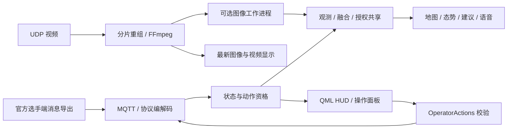

C++ 宿主组织网络、协议、状态与输入端点，QML 绑定展示状态并提交操作意图。`OperatorActions` 检查身份、权限、上下文及数据有效性后构造上行请求，避免每个面板重复实现协议判断。视觉、共享、建议和语音通过可选服务接入，缺失时基础 MQTT、UDP 解码和 QML 壳层仍可运行。

| 目录 | 主要职责 |
| --- | --- |
| `main.cpp`、`app/` | 启动组合、图形引导、配置、输入与动作校验 |
| `core/` | 公共状态、数据结构和基础工具 |
| `mqtt/` | 消息连接、发布、订阅与网络事件 |
| `protocol/` | Protobuf 定义、字段映射、编码和解码 |
| `udp/` | 视频数据报、分片重组、解码与图像交付 |
| `input/` | 输入端点与原始键鼠协议边界 |
| `plugins/` | 端点接口、扩展包验证、服务目录和生命周期 |
| `extensions/` | 正式可选服务、独立工作进程与 QML 扩展 |
| `qml/` | HUD、地图、角色面板、设置与资源 |
| `docs/` | 技术说明、协议资料和文档插图 |

### 6.2 方案比较与采用理由

| 选择 | 采用原因与收益 | 成本、局限与替代方案 |
| --- | --- | --- |
| Qt / C++ / QML | 复用已有网络、解码、输入捕获和桌面界面；C++ 负责资源与协议，QML 负责声明式呈现 | 需维护 Qt 版本、图形后端和 C++ / QML 边界。网页壳可复用 Web 生态，但本项目仍需原生输入和视频桥接，迁移收益未经对照验证 |
| 直接 FFmpeg 解码 | 在自定义 UDP 分片、码流解析和有界排队处保留明确控制，沿用现有错误恢复和图像交付 | 需自行处理解析器、像素转换及缓冲区寿命。Qt Multimedia 提供更高层接口，也可采用 FFmpeg 后端；没有系统对照测试，不能据此排列性能高低 |
| Qt Quick 3D 内嵌，保留外部桥接 | 复用现有窗口、QML 数据绑定与操作入口，避免把地图变成必需的第二应用 | 场地资源和动态节点仍有显存、绘制与维护成本。UE 适合更复杂的场景制作，但增加独立运行时、打包与跨进程同步成本；当前不以完整 UE 集成为已交付能力 |
| 现有 MQTT / UDP 加版本化契约 | 保持官方接入路径和已实现端点，将队内共享、观测与控制分别授权 | 多节点发现、可靠分发和治理需要额外设计。ROS 2 / DDS、Zenoh 可作为较大传感器网络的候选，但会增加适配、部署与运维面；本项目未以性能基准证明替换必要性 |
| 图像计算采用独立进程 | 便于计算依赖独立部署、超时退出和分别启停，减少重任务直接阻塞界面事件循环的机会 | 帧交付与进程协调有开销；进程分离不自动限制权限、CPU 或内存。原生端点仍同进程运行 |

Qt Quick 场景图支持保留式渲染，并可能使用独立渲染线程；具体路径取决于平台与图形后端，不能把一种运行方式写成所有平台的保证。依据见 [Qt Quick Scene Graph](https://doc.qt.io/qt-6.5/qtquick-visualcanvas-scenegraph.html)。封装层与后端的区别见 [Qt Multimedia](https://doc.qt.io/qt-6.5/qtmultimedia-index.html)。

### 6.3 并发、容量与对象寿命

MQTT 网络事件、UDP 收包与解码、图像计算和界面呈现各自承担不同工作，不应在 GUI 事件处理里执行长时间识别或阻塞网络请求。线程数量与调度由具体端点决定，本架构不承诺固定四线程划分。

视频压缩块使用有界队列，解码结果通过最新图像交换，避免 GUI 因消费较慢持续积压历史帧。QImage 关联帧租约，使用者释放后再归还缓冲区；这属于 CPU 图像寿命管理，不是 GPU 零拷贝。跨线程结果以排队方式回到对象所属线程，禁止工作线程直接操作 QML 对象。

停用可选会话时，需要撤销访问、停止任务、断开回调并回收自有线程。原生动态库仍共享宿主地址空间；进程式图像服务也不是权限沙箱。容量边界用于限制积压，不能替代长时间资源测量。

<a id="mqtt"></a>
## 7. 官方消息与控制链路

### 7.1 主题、载荷与状态合并

官方导出链路采用消息名对应的 MQTT 主题与 Protobuf 二进制载荷，例如 `GameStatus`、`RobotDynamicStatus`。订阅、反序列化、字段合并和 UI 呈现是独立环节，应分别观察消息计数、字段值与更新时间。

当前协议共有 37 类结构、175 个字段，包含 25 类下行、11 类上行和 1 类嵌套结构，完整字段表见[附录](#fields)。字段号、类型和可选性以 [robomaster_custom_client.proto](../protocol/robomaster_custom_client.proto) 为准。

`optional` 字段缺失表示本条消息未提供该值，不应覆盖已知值为零；显式 `0` 或 `false` 则是有效载荷。`repeated` 字段按消息语义解析，不能用数组下标猜测机器人编号或把空列表一概视为失联。

### 7.2 上行与回执

业务面板提交意图后，由宿主校验角色、当前状态、数据年龄、参数边界和权限，再编码发送。UI 中的“已提交”表示请求进入发送路径，只有业务回执或状态同步才能确认服务器结果；MQTT 发布成功本身不等于机器人完成操作。

`KeyboardMouseControl` 由专用捕获管线产生，不能通过普通协议编辑器绕过输入开关。自定义字节编辑器只负责构造载荷，打开和修改不自动发送；发送前仍需核对目标和长度限制。

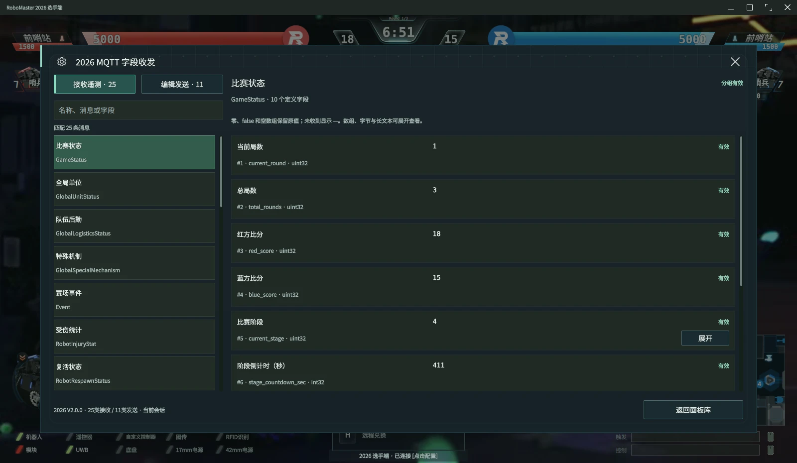

图 11：协议视图用于检查消息接收、字段状态与获准的上行编辑。原始键鼠输入沿用专用边界。

### 7.3 时效、断连与兼容性

消息接收时间与物理采样时间不能混为一谈。资格判断使用对应状态及其时效，陈旧消息不得持续授权动作。断连后停止依赖实时资格的操作，重连和切换身份时重建正确上下文，避免将旧身份状态用到新机器人。

协议字段与编解码实现见 [ProtocolCodec.cpp](../protocol/src/ProtocolCodec.cpp)。2027 规则文件的存在不等于 2027 通信字段已经实现；赛季配置、场地参考系与线缆协议分别版本化。

<a id="video"></a>
## 8. 视频接收与解码

### 8.1 普通 UDP 主视频

程序从 UDP 收包，读取自定义头，重组压缩传输块，交给码流解析器，再由 FFmpeg 解码并转换为用于 Qt Quick 显示的图像。主视频支持 H.264 与 HEVC，编码和实际输入必须一致。

UDP 头部为 **8 字节、大端序**：

| 偏移 | 类型 | 含义 |
| --- | --- | --- |
| 0 | `uint16` | 传输块序号 |
| 2 | `uint16` | 分片序号 |
| 4 | `uint32` | 完整传输块的字节数 |

一个传输块不保证正好对应一个完整视频帧。码流解析器需要处理跨块或同块中的访问单元，再向解码器送包；不能以“收到一块”推断“已解出一帧”。丢片、乱序、超时、异常长度和切换来源分别处理，队列与重组窗口有界。

实现入口：[DatagramAssembler.h](../udp/include/DatagramAssembler.h)、[VideoReceiver.cpp](../udp/src/VideoReceiver.cpp)。FFmpeg 的送包 / 取帧状态机与排空要求见 [libavcodec API](https://ffmpeg.org/doxygen/7.1/group__lavc__encdec.html)。

### 8.2 英雄 H.264 输入

英雄视频由 `CustomByteBlock` 传入，具备独立的分片、解析和解码状态。`plugins.video.hero_video` 控制是否启用及 `annexb` / `compact` 输入格式；部署状态、机器人身份和会话均有效时才选择该视频，失效或异常后回主视频。

`CustomByteBlock` 的单块载荷限制与频率预算来自相应协议，不能按普通 UDP 的大传输块发送。H.264 可能跨多个块才形成完整访问单元；`missing picture in access unit` 一类日志需要结合参数集、分片连续性、格式和帧计数判断，不能仅通过关闭日志处理。

### 8.3 图像交付给识别与界面

显示使用最新图像，识别按其配置抽取解码帧并限制作业。主视频、英雄输入与视觉候选应保留源标识和帧上下文，切换视频后不得继续把旧检测框贴在新画面。视频显示、检测吞吐和端到端时延是不同指标；本手册不提供未经统一输入与硬件条件验证的性能数字。

<a id="plugin-isolation"></a>
## 9. 扩展边界与生命周期

### 9.1 四种扩展形态

| 形态 | 典型用途 | 装载与边界 |
| --- | --- | --- |
| 原生 Qt 端点 | MQTT、协议、视频、状态、输入与策略 | 使用 C++ / Qt 插件接口，和宿主同进程；不是扩展包工厂接口 |
| QML 目录扩展 | 三维地图、赛季工作区等 | 宿主通过明确 Loader 按需装载；不是任意目录都能自动发现 |
| `rmplugin.json` 扩展包 | 版本化服务、通道和独立面板 | 清单、依赖、配置与包资源先校验，明确启用后激活 |
| 计算工作进程 | YOLO、吊射图像候选 | 私有有界 IPC 和工作进程生命周期；依赖和故障范围相对独立 |

`hero.lob.video` 是编译时可选的内部宿主能力，不是单独发现的 `rmplugin.json` 包。YOLO 与吊射候选使用各自图像进程，由协调器连接共享与融合；仅切换相应图像能力时可保留另一工作进程和队内会话，公共配置改变则可能重启协调器。

默认端点选择包括 `mqtt.mosquitto`、`protocol.rm2026.v2`、`video.ffmpeg`、`state.telemetry`、`input.qt`、`policy.operator`。可替换端点需要实现相应接口；不能因为它们采用插件接口，就宣称移除任何一个基础实现后仍拥有相同通信功能。

### 9.2 包服务与总线

包清单分别声明导出服务、必需服务、可选服务以及发布 / 订阅通道。必需服务缺失时拒绝激活；可选服务缺失时由包提供降级行为。`core.*` 与 `foundation.*` 名称保留给基础设施，第三方不能覆盖既有服务。包 ID、名称与作者只是清单信息，不是身份认证。

包内消息不会自动成为网络共享、规范观测或机器人控制命令，需要明确适配与授权。宿主为包络固定 `authoritative: false`、`execution_allowed: false`。单条载荷上限 4 KiB，待派发队列最多 64 条 / 256 KiB；`publish` 返回 false 时发布者须停止积压并报告错误。

### 9.3 原生包会话

工厂实现 `ExtensionPackagePlugin`，通过 Qt 元对象声明接口，`create(host, owner)` 返回实现 `ExtensionPackageSession` 的 QObject。会话以传入 owner 为父对象，创建时保持静止，`start(QString *error)` 完成启动并注册已声明导出；`stop() noexcept` 负责终止。

`stop()` 必须幂等，启动失败后也能安全调用。返回前取消自有任务和计时器、断开外部回调并回收自有线程；不能留下继续访问 host 的工作。跨线程结果回到会话所属线程后再调用宿主。动态库热替换和 ABI 变更应安排重启，不将原生库重新装载当作无条件安全操作。

这些守卫减少悬垂回调和生命周期错误，但原生库的非法内存访问仍可能影响整个客户端。接口依据：[ExtensionPackage.h](../plugins/include/ExtensionPackage.h)、[ClientPlugin.h](../plugins/include/ClientPlugin.h)、[ExtensionPlugin.h](../plugins/include/ExtensionPlugin.h)。

<a id="contracts"></a>
<a id="situation-platform"></a>
## 10. 观测、共享与态势契约

### 10.1 统一观测格式

独立态势链路使用 `rm.situation/1` 版本，实际校验定义见 [contract.py](../extensions/battlefield/runtime/contract.py)。以下是观测项的字段，不是官方 MQTT 消息，也不是队伍 schema3 报文。

| 字段 | 含义与约束 |
| --- | --- |
| `source_id`、`target_id` | 来源与目标标识；未知目标按节点 / 会话区分 |
| `sequence` | 正序列号，支持重复与乱序判断 |
| `stamp_ms`、`ttl_ms` | 采样 UTC 毫秒与有效期；有效期为 50–5000 毫秒 |
| `kind` | `vision`、`radar`、`odometry`、`position`、`sensor`、`telemetry` |
| `team` | `red`、`blue`、`unknown` |
| `frame_id` | 坐标参考系或相机帧标识 |
| `confidence` | 0–1 来源评分；不同生产者的评分不自动可比 |
| `position`、`uncertainty_m` | 可选二维米制位置；带位置必须提供误差估计 |
| `heading` | 可选朝向，弧度；按相应参考系解释 |
| `bbox` | 可选归一化 `[x,y,width,height]`，范围受图像边界约束 |
| `calibration_id`、`estimated` | 可选标定版本与估计标记 |
| `value`、`data_type`、`unit` | 标量、布尔、文本或向量传感器值；单位明确 |
| `label`、`image_trail` | 可选标签及有界图像轨迹历史 |

`source_id`、`target_id`、`sequence`、`stamp_ms`、`ttl_ms`、`kind`、`team`、`frame_id` 和 `confidence` 九个字段必填，且至少提供 `position`、`bbox` 或 `value` 之一。未知键、非法数值、越界框和不合法时间被拒绝。转发不更新原采样时间，不靠重新发送延长有效期；接收节点需要满足链路的时钟同步要求。

### 10.2 共享授权与两类队内实现

| 实现 | 传输与身份 | 用途和限制 |
| --- | --- | --- |
| 独立态势链路 | 认证 UDP，按节点密钥与可信对端配置校验 | 共享规范观测、可选融合视图与文本；不是加密隧道，网络信任边界必须明确 |
| `terminal.team@3` | 专用 mTLS MQTT 契约，结合应用签名、节点权限和上下文 | 已有独立实现；启用须满足该契约的配置与上下文，不能直接套用态势 UDP 配置 |

队内链路与官方 MQTT 的凭据、主题和授权分别管理。“分开”指应用契约与权限边界，不保证占用物理独立网卡。官方数据、视觉数据、融合结果、语音文本各自需要共享许可；来源未授权、消息过期、重放或上下文不符时拒绝。

队伍 schema3 的精确字段、签名与配额以 [TerminalTeamContract.h](../extensions/terminal-team/include/TerminalTeamContract.h) 和 [TerminalTeamProofVerifier.h](../extensions/terminal-team/include/TerminalTeamProofVerifier.h) 为准。规范观测与包总线信封也属于不同接口，不应混用字段。

### 10.3 融合与冲突

融合前先检查参考系、目标身份、时间和来源许可。不能将不同观察者的未知编号直接合为同一辆车，也不能把相机框与地图米制位置无条件混算。兼容来源可形成 `fused_estimate`；明显冲突保留证据和冲突状态，不强给一个确定位置。

共享融合视图使用 `rm.situation.fused/1`，顶层包含 `frame_id`、`revision`、`stamp_ms`、`expires_ms`、`tracks`、`omitted_tracks`。轨迹保留位置、朝向、阵营、评分、时间、状态、冲突、证据和历史；冲突位置必须保持未知，容量与时效均校验。来源诊断评分仅用于工程排序和提示，不是实测定位误差的统计置信区间。

### 10.4 呈现与外部渲染接口

态势窗口、主界面小地图与三维地图应呈现来源和估计性质，避免将视觉候选绘成官方确定事实。二维渲染服务采用 `renderer-scene/1` 输入和 `renderer-projection/1` 输出，处理参考系、上下文、年龄预算与屏幕投影；公开接口见[二维渲染接口说明](../extensions/terminal-renderer/README.md)。

外部桥接只导出受约束的查看数据，不提供机器人控制权限。UE 等外部引擎接入还需实现坐标、时间、实体寿命和进程通信适配，并单独验证部署成本；当前桥接状态页面不能作为完整 UE 应用已经交付的证据。

<a id="laboratory-2027"></a>
## 11. 赛季能力与可选工作区

### 11.1 规则依据与协议状态

工程归档了 2026-10-15 发布的 2027 赛季 V1.0.0 [比赛规则](references/rm2027/rmuc2027-rules-v1.0.0-20261015.pdf)、[机器人制作规范](references/rm2027/rm2027-robot-specifications-v1.0.0-20261015.pdf) 与 [参赛手册](references/rm2027/rmuc2027-participant-v1.0.0-20261015.pdf)，来源记录见 [官方资料索引](references/official/manifest.json)。

工程的[协议资料记录](protocol/source.json)仍为 `publication_pending`，表示此工程尚未完成 2027 通信细则归档和映射；这不构成对所有公开渠道发布状态的实时判断。现有 2026 主题与字段不能直接改名为 2027 协议。

### 11.2 三个可选工作区

| 工作区 | 解决的问题与操作价值 | 成本和边界 |
| --- | --- | --- |
| `season.readiness` 赛季就绪审计 | 汇总规则版本、场地和能力配置，暴露缺失项，减少不同资料版本混用 | 依赖维护能力条目；只提供工程就绪提示，不是赛事认证 |
| `team.tactical-timeline` 队内战术时间线 | 记录并共享人工战术事件，区分历史记录与仍有效标注 | 需要时间、共享许可与去重；人工事件不作为位置融合证据 |
| `situation.source-health` 来源诊断 | 展示来源年龄、过期、掉线与冲突，帮助判断为何没有可用估计 | 阈值和评分属于诊断规则，不证明传感器真实精度 |

这些扩展由各自目录和 Loader 管理，按需启用，不因缺失阻断主窗口。工作区对 2027 的适用性分三层：已归档规则可作为资料依据，配置审计属于工程实现，涉及未确认协议或实地定位的能力仍为待验证项。

### 11.3 后续接入路径

收到明确协议资料后，先新增独立赛季配置和字段映射，再核对坐标、身份与资格规则；保留原协议解析并验证缺失扩展回退。实地相机和场地标定完成后，再评估视觉位置精度与资源占用。外部三维引擎仅在当前展示无法满足明确需求、且部署成本可接受时继续接入。

<a id="authoring"></a>
## 12. 扩展包 SDK 与开发

### 12.1 清单与资源组织

一个扩展包至少包含 `rmplugin.json` 与 QML 生命周期入口，可另带独立面板、资源、说明和原生库。所有资源位于包内并明确列入打包清单；不把缓存、识别权重或无关文件一起打包。以下是无外部服务依赖的有效清单示例：

```json
{
  "schema": 1,
  "id": "example.viewer",
  "version": "1.0.0",
  "apiMajor": 1,
  "entry": "Main.qml",
  "services": {
    "exports": [],
    "required": [],
    "optional": []
  },
  "channels": {
    "publish": [
      "example.viewer.events@1"
    ],
    "subscribe": []
  },
  "panels": [
    {
      "id": "main",
      "title": "状态查看",
      "entry": "Panel.qml"
    }
  ],
  "configuration": {
    "defaults": {
      "title": "状态查看"
    },
    "schema": {
      "type": "object",
      "properties": {
        "title": {
          "type": "string",
          "minLength": 1,
          "maxLength": 80
        }
      },
      "required": [
        "title"
      ],
      "additionalProperties": false
    }
  }
}
```

`services` 与 `channels` 中的名称带契约版本，例如 `example.viewer.events@1`。实际需要 `terminal.data@3` 的包，应将它列入 `required` 或 `optional`，并分别处理依赖缺失；仅在清单写入名称不会创建该服务。

配置引擎支持受约束的 JSON Schema 子集：对象声明 `properties`、`required` 和 `additionalProperties: false`，数组显式限制 `maxItems`，值在保存前校验。保存提交完整配置对象；缺失与显式 false / 0 的语义不同，不能擅自补成默认枚举。清单不增加未支持的 `documentation` 字段，说明文件通过 `FILES` 随包交付。

### 12.2 QML 上下文 API

宿主为包入口注入 `pluginContext`，不同于应用全局上下文。配置在一次激活周期中只读；保存新配置后由宿主停止旧实例并按新配置激活。服务拓扑改变时，包监听 `servicesRevision` 并重新获取引用，不能永久保留失效服务指针。

| 属性 / 方法 | 用途与返回值 |
| --- | --- |
| `packageId`、`packageDirectory` | 包身份和资源目录；目录不能作为对外身份凭据 |
| `configuration`、`active` | 当前完整配置与激活状态 |
| `servicesRevision` | 服务依赖拓扑变化计数 |
| `service(name)` | 查询已声明依赖 / 自身导出，未声明或缺失时返回空 |
| `registerService(name, object)` | 注册清单声明且归本包所有的导出；不允许覆盖其它服务 |
| `publish(channel, payload)` | 向已声明发布通道排队，返回是否接受；不自动发到网络 |
| `subscribe(channel, callback)` | 订阅已声明通道，返回注销 token |
| `unsubscribe(token)` | 解除对应订阅 |
| `createTimer(milliseconds, repeat, callback)` | 创建托管计时器并返回 token |
| `cancelTimer(token)` | 取消对应托管计时器 |
| `ownObject(object)` | 将合法对象纳入本包寿命管理 |

面板声明的入口根应为 `QQuickItem`，由宿主创建并设置所有权，不能假设每次打开都得到永久全局对象。根入口负责包级订阅和状态，面板负责呈现；面板关闭不应留下继续调用已销毁对象的回调。

### 12.3 原生接口与构建接入

SDK 通过 `ClientPluginSDK` CMake 包导出接口，原生包使用 `RoboMaster::package_api`。工厂、会话和宿主接口见 [ExtensionPackage.h](../plugins/include/ExtensionPackage.h)，C++ / Qt ABI、编译器、运行库和 Qt 版本须与宿主兼容。该接口不是通用 C 工厂 ABI。

安装 SDK 时，`BUILD_DIR` 和 `SDK_PREFIX` 由部署工程指定：

```bash
cmake --install "$BUILD_DIR" --prefix "$SDK_PREFIX" --component PluginSDK
```

扩展工程的 CMake 接入片段如下；`Main.qml`、`Panel.qml`、`README.md` 和上述清单均须先存在。原生目标如有需要，应在调用打包函数前定义。

```cmake
cmake_minimum_required(VERSION 3.19)
project(ExampleViewer LANGUAGES CXX)
find_package(ClientPluginSDK 1.12 REQUIRED)

robomaster_package_extension(
    NAME example_viewer_bundle
    MANIFEST rmplugin.json
    FILES Main.qml Panel.qml README.md
    OUT_DIRECTORY example_package_directory
)
```

`OUT_DIRECTORY` 接受输出变量名，不接受目标目录路径。函数生成带构建配置的交付包目录；清单自身由打包函数处理，不在 `FILES` 中重复声明。使用 `NATIVE_TARGET` 时，函数把已定义的 MODULE / SHARED 目标加入 `native/`，并生成交付清单中的 native 信息；源码清单省略该字段。

打包函数检查显式文件、相对路径、重复项与容量；当前单文件不超过 8 MiB，交付包不超过 32 MiB。它会替换自己拥有的生成包目录，运行前应确认输出范围符合工程的文件保留要求，不指向已有资料。实现见 [RoboMasterExtensionPackage.cmake](../plugins/cmake/RoboMasterExtensionPackage.cmake)。

启动客户端时可通过 `--package-dir` 指定包搜索目录，通过 `--package-config` 指定启用与配置记录。发现包后仍需操作员检查并启用。发布新原生库前检查兼容性和依赖，不由宿主自动下载缺失运行库。

<a id="configuration"></a>
## 13. 配置、构建与部署

### 13.1 构建依赖

| 依赖 | 要求 / 用途 |
| --- | --- |
| C++ | C++17 编译器 |
| CMake | 工程最低 3.19；随附 Presets 需要 3.21 及以上 |
| Qt | 最低 6.5，Core / Gui / Network / Qml / Quick / QuickControls2；三维功能还需对应模块 |
| Protobuf | 支持 proto3 optional 的 3.15 及以上兼容版本，运行库和 protoc 应匹配 |
| libmosquitto | MQTT 连接与消息发布 / 订阅 |
| FFmpeg | avcodec / avutil / swscale 等视频依赖 |
| Python 图像计算 | 仅视觉能力需要相应解释器与 numpy、OpenCV、ONNX Runtime |
| 语音服务 | 按选定实现提供合成程序或 HTTP 服务，以及需要的播放设备 |

可用 Qt 安装前缀通过 `QT_PREFIX` 提供，在项目根目录配置与构建：

```bash
cmake --preset release -DCMAKE_PREFIX_PATH="$QT_PREFIX"
cmake --build --preset release
```

构建目录由预设声明，配置结束时 CMake 会打印实际输出位置；可执行文件名为 `RoboMasterMqttTest`。安装后从安装目录的 `bin` 启动同名程序。对包含符号链接的旧构建目录，应使用它的真实路径或单独预设重新配置，避免相对协议依赖指向错误位置。

运行时需要可用的 Qt 平台和图形插件、QML 模块、消息库及视频库。Qt Quick 3D、识别运行环境、语音合成和第三方权重按启用能力交付，不把所有可选依赖强制加入基础客户端。现有运行截图来自 Linux / Qt 环境，不据此宣称所有桌面平台均已完成部署验收。

### 13.2 三类配置的职责

| 配置 | 管什么 | 如何生效 |
| --- | --- | --- |
| 连接面板当前选项 | MQTT、UDP、身份 | 连接 / 重新连接 / 应用 UDP |
| 界面与快捷键偏好 | 布局、动效、绑定和显示习惯 | 经界面保存；不直接触发机器人动作 |
| 扩展完整配置 / 包配置 | 依赖、来源、识别、共享、语音与策略 | 校验后明确应用或重新激活 |

完整态势配置使用 `rm.situation.config/1`，包括节点、队伍、比赛、参考系、许可及各能力节点。可从[模板](../extensions/battlefield/config/default.json)起步，再由界面配置部署参数。视觉 `vision` 或吊射 `projectile` 节点只是局部配置，不能单独充当完整配置文件。

凭据使用实现支持的环境变量引用，例如共享链路 `team.key_env`。公开模板、文档和版本库只保留引用名称，不放入实际密钥或令牌。修改服务目标、共享范围或参考系时，检查所有发送端、接收端与许可配置的一致性。

### 13.3 资源与许可

运行素材、字体和三维场地资源与程序一起保留；文档插图用于说明界面，不作为额外运行依赖。涉及来源与再分发的限制，分别见 [UI 素材许可](../qml/resources/player/SOURCE-ASSET_LICENSES.md) 和 [场地资源说明](../extensions/battlefield-3d/assets/CAD-NOTICE.md)。

<a id="troubleshooting"></a>
## 14. 故障定位与验收边界

### 14.1 常见问题

| 现象 | 检查顺序 |
| --- | --- |
| MQTT 未连接 | 核对官方导出目标、端口、网卡路由、身份与错误；从连接面板重新连接 |
| MQTT 已连接但无字段更新 | 检查订阅主题、身份、Protobuf 解码及实际更新时间；连接成功不能证明有有效消息 |
| UDP 绑定正常但黑屏 | 核对发送方目标网卡和端口、来源锁定、H.264 / HEVC、分片和参数集，再看解码帧是否递增 |
| 英雄已部署但仍无独立画面 | 检查独立视频能力、部署状态时效、`CustomByteBlock` 输入、格式和帧连续性 |
| 吊射画面正常但无轨迹 | 区分视频和候选检测是否分别启用，检查画质、区域和候选证据；无候选不等于解码失败 |
| UI 快捷键没有反应 | 激活客户端，退出文本编辑，核对当前面板 / 角色和自定义绑定；普通面板快捷键无需开启捕获 |
| 机器人端没有原始键鼠 | 检查捕获意图、是否被面板暂停、窗口焦点、MQTT 身份与输入端点 |
| 按 H 没有兑换面板 | 检查角色和远程兑换资格；工程、空中角色会打开各自面板 |
| 地图点击没有标记 | 使用 250 毫秒长按、向右滑到有效扇区后松开，并检查权限与回传 |
| YOLO 无检测框 | 检查启用状态、依赖、权重、输出格式、标签、过滤与视频帧；不以未知身份充当已识别敌方 |
| 队友未看到视觉信息 | 检查共享许可、可信节点、参考系、采样时间、有效期及接收状态；接收端不必启动检测 |
| 语音显示就绪但无声音 | 分别检查服务连接、合成、静音、仅合成模式和播放设备，不把就绪当作已播放 |
| 切换连接时窗口状态改变 | 连接动作应保留全屏状态；记录实际触发入口与 F11 状态，作为窗口行为缺陷定位 |
| 新扩展无法启用 | 检查清单版本、配置 Schema、必需服务、通道声明、库兼容性和资源是否完整 |

### 14.2 验收判据

| 范围 | 应观察到的结果 | 不能据此推断 |
| --- | --- | --- |
| 核心消息 | 身份、字段与更新时间正确，动作有校验与回执 | MQTT 连接成功即全协议无误 |
| 主视频与英雄输入 | 有实际解码帧，切换与失效回退可见 | 收到字节就代表完整帧或识别成功 |
| 快捷键与窗口 | 按住 / 切换 / 确认语义一致，编辑不误触，全屏不受重连影响 | 所有键在任意上下文都应执行 |
| 地图与视觉 | 标注有回传，来源和估计可区分，过期撤回 | 视觉框等于已确认地图坐标 |
| 可选扩展 | 启停、依赖缺失、断连和错误有状态，核心继续更新 | 原生扩展已获得操作系统级隔离 |
| 语音与建议 | 依据、时间和状态明确，静音及设备错误可见 | 建议自动执行或语音已进入官方频道 |
| 缩放与资源 | 典型窗口比例下无遮挡，长时间观察队列和资源变化 | 一次截图或编译通过就能证明性能稳定 |

本版文档配图已通过当前程序的实际窗口采集，包含消息与视频更新、状态 / 帮助 / 快捷键面板、二维 / 三维地图及长按标注过程。这些图证说明对应交互可以运行，不替代实车识别精度、完整赛事网络、长时间资源占用或全部平台的专项验收。

尚需结合实体设备确认的项目包括：相机内外参及云台时序、视觉身份准确率、复杂光照下弹丸候选、2027 实地坐标和正式协议映射。性能数据须同时记录输入、平台、版本与测量边界，本手册不将推测收益写成实测结论。

<a id="pages"></a>
## 15. 官方选手手册页面对应

以下按 2026 选手手册的 1–28 页组织查阅入口。页面主题是阅读索引，不表示所有截图都必须逐像素照搬；布局采用当前窗口条件，协议与操作语义仍须保持明确。

| 页 | 页面主题 | 当前程序的阅读 / 操作入口 |
| --- | --- | --- |
| <a id="page-01"></a>1 | 主界面与视野 | [主界面](#visual)，中央视频与 HUD |
| <a id="page-02"></a>2 | 基地 | [顶部状态](#visual)，基地血量与增益槽 |
| <a id="page-03"></a>3 | 前哨站与地面机器人队列 | [顶部状态](#visual)，前哨站与分格血量 |
| <a id="page-04"></a>4 | 增益与地形 | Ctrl+Shift+F，[地图来源](#maps) |
| <a id="page-05"></a>5 | 比赛信息、经济与堡垒 | [主界面](#visual)、Tab 状态表与相关详情 |
| <a id="page-06"></a>6 | 射击信息 | [主界面](#visual)、[协议字段](#fields)中的射击与机器人状态 |
| <a id="page-07"></a>7 | 自身状态、模块与判罚 | 按住反引号、消息通知与判罚字段 |
| <a id="page-08"></a>8 | 消息通知与机器人信息 | [主界面](#visual)、Tab 状态表 |
| <a id="page-09"></a>9 | 战亡显示 | [复活快捷键](#shortcuts)，战亡提示和状态同步 |
| <a id="page-10"></a>10 | 免费与付费复活 | 战亡界面 F1 / Y，检查资格与回执 |
| <a id="page-11"></a>11 | 飞镖 | Ctrl+Shift+J，[飞镖快捷键](#shortcuts) |
| <a id="page-12"></a>12 | 能量机关与哨兵 RFID | 步兵 F 长按与相关资格显示 |
| <a id="page-13"></a>13 | 远程兑换 | 符合资格时 H，[兑换快捷键](#shortcuts) |
| <a id="page-14"></a>14 | 工程基础装配 | 工程 H、难度键与 Enter |
| <a id="page-15"></a>15 | 工程四级协作与退出 | 工程 Y / Ctrl+Y / L 与上下文校验 |
| <a id="page-16"></a>16 | 空中支援 | 空中 H、Ctrl+1 / 2 / 3 与 N |
| <a id="page-17"></a>17 | 英雄部署与吊射视频 | 英雄 K / L，[独立视频](#video)与[候选辅助](#management) |
| <a id="page-18"></a>18 | 小地图 | [长按滑动信号](#maps)，官方位置与估计分层 |
| <a id="page-19"></a>19 | Tab 状态表 | 按住 Tab；面板库也可打开查看 |
| <a id="page-20"></a>20 | 伤害统计与模块 | 按住反引号 |
| <a id="page-21"></a>21 | 设置与性能 | P，[布局与设置](#visual) |
| <a id="page-22"></a>22 | 17mm 弹药兑换 | 步兵 O，选择、数量和确认分开 |
| <a id="page-23"></a>23 | 42mm 弹药与兑换结果 | 英雄 I，查看业务结果 |
| <a id="page-24"></a>24 | 大地图与副屏 | M、Ctrl+Shift+F9，[地图](#maps) |
| <a id="page-25"></a>25 | 哨兵与云台手支援 | 哨兵角色面板与飞镖独立权限 |
| <a id="page-26"></a>26 | 帮助和快捷键 | 按住 F12、Ctrl+Shift+K，[快捷键完整表](#shortcuts) |
| <a id="page-27"></a>27 | 比赛结束与胜负 | 结束状态与结算展示，不以计时归零替代结果 |
| <a id="page-28"></a>28 | 结算详情 | 结算详情面板和消息字段，缺失值保持未知 |

<a id="fields"></a>
## 附录 A：官方协议结构与字段

本附录按当前协议源码整理，覆盖 37 类结构与 175 个字段。编号是 Protobuf 字段号，不是枚举值。`optional` 表示有存在性，`repeated` 表示列表；未标记的单值按 proto3 语义处理。这里的“上行 / 下行”相对于自定义客户端，嵌套结构不单独作为 MQTT 主题发送。

字段类型与可选性不可因界面布局变化而修改。参数范围、枚举含义、发送权限与频率预算仍须结合协议注释和动作校验实现；表中未列出的约束不等于允许任意值。

| 消息 / 结构 | 方向 | 字段数 |
| --- | --- | --- |
| [`KeyboardMouseControl`](#msg-KeyboardMouseControl) · 键鼠输入 | 上行 | 7 |
| [`CustomControl`](#msg-CustomControl) · 自定义控制数据 | 上行 | 1 |
| [`GameStatus`](#msg-GameStatus) · 比赛状态 | 下行 | 10 |
| [`GlobalUnitStatus`](#msg-GlobalUnitStatus) · 全局单位 | 下行 | 14 |
| [`GlobalLogisticsStatus`](#msg-GlobalLogisticsStatus) · 队伍后勤 | 下行 | 4 |
| [`GlobalSpecialMechanism`](#msg-GlobalSpecialMechanism) · 特殊机制 | 下行 | 2 |
| [`Event`](#msg-Event) · 赛场事件 | 下行 | 2 |
| [`RobotInjuryStat`](#msg-RobotInjuryStat) · 受伤统计 | 下行 | 10 |
| [`RobotRespawnStatus`](#msg-RobotRespawnStatus) · 复活状态 | 下行 | 6 |
| [`RobotStaticStatus`](#msg-RobotStaticStatus) · 机器人静态状态 | 下行 | 14 |
| [`RobotDynamicStatus`](#msg-RobotDynamicStatus) · 机器人动态状态 | 下行 | 13 |
| [`RobotModuleStatus`](#msg-RobotModuleStatus) · 机器人模块 | 下行 | 11 |
| [`RobotPosition`](#msg-RobotPosition) · 机器人位置 | 下行 | 5 |
| [`Buff`](#msg-Buff) · 增益 | 下行 | 5 |
| [`PenaltyInfo`](#msg-PenaltyInfo) · 判罚 | 下行 | 3 |
| [`RobotPathPlanInfo`](#msg-RobotPathPlanInfo) · 规划路径 | 下行 | 6 |
| [`MapClickInfo`](#msg-MapClickInfo) · 地图标记同步 | 下行 | 8 |
| [`MapClickCmd`](#msg-MapClickCmd) · 地图标记指令 | 上行 | 8 |
| [`RadarSingleRobotInfo`](#msg-RadarSingleRobotInfo) · 单机器人雷达信息 | structure | 3 |
| [`RadarInfoToClient`](#msg-RadarInfoToClient) · 雷达信息 | 下行 | 1 |
| [`CustomByteBlock`](#msg-CustomByteBlock) · 机器人自定义数据 | 下行 | 1 |
| [`AssemblyCommand`](#msg-AssemblyCommand) · 科技核心装配指令 | 上行 | 2 |
| [`TechCoreMotionStateSync`](#msg-TechCoreMotionStateSync) · 科技核心装配状态 | 下行 | 8 |
| [`RobotPerformanceSelectionCommand`](#msg-RobotPerformanceSelectionCommand) · 性能与控制方式选择 | 上行 | 3 |
| [`RobotPerformanceSelectionSync`](#msg-RobotPerformanceSelectionSync) · 性能与控制方式同步 | 下行 | 3 |
| [`CommonCommand`](#msg-CommonCommand) · 通用兑换与复活 | 上行 | 2 |
| [`HeroDeployModeEventCommand`](#msg-HeroDeployModeEventCommand) · 英雄部署指令 | 上行 | 1 |
| [`DeployModeStatusSync`](#msg-DeployModeStatusSync) · 英雄部署状态 | 下行 | 1 |
| [`RuneActivateCommand`](#msg-RuneActivateCommand) · 能量机关激活 | 上行 | 1 |
| [`RuneStatusSync`](#msg-RuneStatusSync) · 能量机关状态 | 下行 | 3 |
| [`SentryStatusSync`](#msg-SentryStatusSync) · 哨兵姿态 | 下行 | 3 |
| [`DartCommand`](#msg-DartCommand) · 飞镖指令 | 上行 | 3 |
| [`DartSelectTargetStatusSync`](#msg-DartSelectTargetStatusSync) · 飞镖目标与闸门 | 下行 | 2 |
| [`SentryCtrlCommand`](#msg-SentryCtrlCommand) · 哨兵控制指令 | 上行 | 1 |
| [`SentryCtrlResult`](#msg-SentryCtrlResult) · 哨兵控制结果 | 下行 | 2 |
| [`AirSupportCommand`](#msg-AirSupportCommand) · 空中支援指令 | 上行 | 1 |
| [`AirSupportStatusSync`](#msg-AirSupportStatusSync) · 空中支援状态 | 下行 | 5 |

<a id="msg-KeyboardMouseControl"></a>
### `KeyboardMouseControl` · 键鼠输入

方向：上行。

| 字段号 | 字段 | 类型 | 可选性 / 数量 | 含义与说明 |
| --- | --- | --- | --- | --- |
| 1 | `mouse_x` | `int32` | optional | 鼠标 X 移动量 |
| 2 | `mouse_y` | `int32` | optional | 鼠标 Y 移动量 |
| 3 | `mouse_z` | `int32` | optional | 鼠标滚轮移动量 |
| 4 | `left_button_down` | `bool` | optional | 鼠标左键 |
| 5 | `right_button_down` | `bool` | optional | 鼠标右键 |
| 6 | `keyboard_value` | `uint32` | optional | 键盘位掩码；仅 bit 0~15 有效：W,S,A,D,Shift,Ctrl,Q,E,R,F,G,Z,X,C,V,B。 |
| 7 | `mid_button_down` | `bool` | optional | 鼠标中键 |

<a id="msg-CustomControl"></a>
### `CustomControl` · 自定义控制数据

方向：上行。

| 字段号 | 字段 | 类型 | 可选性 / 数量 | 含义与说明 |
| --- | --- | --- | --- | --- |
| 1 | `data` | `bytes` | optional | 字节数据 |

<a id="msg-GameStatus"></a>
### `GameStatus` · 比赛状态

方向：下行。

| 字段号 | 字段 | 类型 | 可选性 / 数量 | 含义与说明 |
| --- | --- | --- | --- | --- |
| 1 | `current_round` | `uint32` | optional | 当前局数 |
| 2 | `total_rounds` | `uint32` | optional | 总局数 |
| 3 | `red_score` | `uint32` | optional | 红方比分 |
| 4 | `blue_score` | `uint32` | optional | 蓝方比分 |
| 5 | `current_stage` | `uint32` | optional | 比赛阶段；0 未开始，1 准备，2 自检，3 倒计时，4 比赛中，5 结算中。 |
| 6 | `stage_countdown_sec` | `int32` | optional | 阶段倒计时（秒） |
| 7 | `stage_elapsed_sec` | `int32` | optional | 阶段已过时间（秒） |
| 8 | `is_paused` | `bool` | optional | 比赛暂停 |
| 9 | `game_result` | `uint32` | optional | 当局结果；0 平局，1 红方胜，2 蓝方胜；非结算阶段为 255。 |
| 10 | `end_reason` | `uint32` | optional | 结束原因；1~9；非结算阶段为 255。 |

<a id="msg-GlobalUnitStatus"></a>
### `GlobalUnitStatus` · 全局单位

方向：下行。

| 字段号 | 字段 | 类型 | 可选性 / 数量 | 含义与说明 |
| --- | --- | --- | --- | --- |
| 1 | `base_health` | `uint32` | optional | 己方基地血量 |
| 2 | `base_status` | `uint32` | optional | 己方基地状态 |
| 3 | `base_shield` | `uint32` | optional | 己方基地护盾 |
| 4 | `outpost_health` | `uint32` | optional | 己方前哨站血量 |
| 5 | `outpost_status` | `uint32` | optional | 己方前哨站状态 |
| 6 | `enemy_base_health` | `uint32` | optional | 对方基地血量 |
| 7 | `enemy_base_status` | `uint32` | optional | 对方基地状态 |
| 8 | `enemy_base_shield` | `uint32` | optional | 对方基地护盾 |
| 9 | `enemy_outpost_health` | `uint32` | optional | 对方前哨站血量 |
| 10 | `enemy_outpost_status` | `uint32` | optional | 对方前哨站状态 |
| 11 | `robot_health` | `uint32` | repeated | 机器人血量数组；数组顺序：己方 1、2、3、4、7；对方 1、2、3、4、7。空缺项不补造血量。 |
| 12 | `robot_bullets` | `int32` | repeated | 己方剩余累计发弹量数组；官方V2.0.0字段12为剩余累计发弹量，不是已发射总数。该表未明示数组顺序；当前五槽适配映射仍待选手端导出／设备核验，不推算缺失弹量。 |
| 13 | `total_damage_ally` | `uint32` | optional | 己方总伤害 |
| 14 | `total_damage_enemy` | `uint32` | optional | 对方总伤害 |

<a id="msg-GlobalLogisticsStatus"></a>
### `GlobalLogisticsStatus` · 队伍后勤

方向：下行。

| 字段号 | 字段 | 类型 | 可选性 / 数量 | 含义与说明 |
| --- | --- | --- | --- | --- |
| 1 | `remaining_economy` | `uint32` | optional | 剩余金币 |
| 2 | `total_economy_obtained` | `uint64` | optional | 累计获得金币 |
| 3 | `tech_level` | `uint32` | optional | 科技等级 |
| 4 | `encryption_level` | `uint32` | optional | 加密等级 |

<a id="msg-GlobalSpecialMechanism"></a>
### `GlobalSpecialMechanism` · 特殊机制

方向：下行。

| 字段号 | 字段 | 类型 | 可选性 / 数量 | 含义与说明 |
| --- | --- | --- | --- | --- |
| 1 | `mechanism_id` | `uint32` | repeated | 机制编号数组 |
| 2 | `mechanism_time_sec` | `int32` | repeated | 机制时间数组（秒） |

<a id="msg-Event"></a>
### `Event` · 赛场事件

方向：下行。

| 字段号 | 字段 | 类型 | 可选性 / 数量 | 含义与说明 |
| --- | --- | --- | --- | --- |
| 1 | `event_id` | `int32` | optional | 事件编号 |
| 2 | `param` | `string` | optional | 事件参数 |

<a id="msg-RobotInjuryStat"></a>
### `RobotInjuryStat` · 受伤统计

方向：下行。

| 字段号 | 字段 | 类型 | 可选性 / 数量 | 含义与说明 |
| --- | --- | --- | --- | --- |
| 1 | `total_damage` | `uint32` | optional | 总扣血量 |
| 2 | `collision_damage` | `uint32` | optional | 碰撞扣血 |
| 3 | `small_projectile_damage` | `uint32` | optional | 17 mm 弹丸扣血 |
| 4 | `large_projectile_damage` | `uint32` | optional | 42 mm 弹丸扣血 |
| 5 | `dart_splash_damage` | `uint32` | optional | 飞镖溅射扣血 |
| 6 | `module_offline_damage` | `uint32` | optional | 模块离线扣血 |
| 7 | `offline_damage` | `uint32` | optional | 离线扣血 |
| 8 | `penalty_damage` | `uint32` | optional | 判罚扣血 |
| 9 | `server_kill_damage` | `uint32` | optional | 服务器判定扣血 |
| 10 | `killer_id` | `uint32` | optional | 击杀者编号 |

<a id="msg-RobotRespawnStatus"></a>
### `RobotRespawnStatus` · 复活状态

方向：下行。

| 字段号 | 字段 | 类型 | 可选性 / 数量 | 含义与说明 |
| --- | --- | --- | --- | --- |
| 1 | `is_pending_respawn` | `bool` | optional | 等待复活 |
| 2 | `total_respawn_progress` | `uint32` | optional | 复活读条总长度 |
| 3 | `current_respawn_progress` | `uint32` | optional | 当前复活进度 |
| 4 | `can_free_respawn` | `bool` | optional | 可免费复活 |
| 5 | `gold_cost_for_respawn` | `uint32` | optional | 立即复活所需金币 |
| 6 | `can_pay_for_respawn` | `bool` | optional | 可付费复活 |

<a id="msg-RobotStaticStatus"></a>
### `RobotStaticStatus` · 机器人静态状态

方向：下行。

| 字段号 | 字段 | 类型 | 可选性 / 数量 | 含义与说明 |
| --- | --- | --- | --- | --- |
| 1 | `connection_state` | `uint32` | optional | 连接状态 |
| 2 | `field_state` | `uint32` | optional | 上场状态 |
| 3 | `alive_state` | `uint32` | optional | 存活状态 |
| 4 | `robot_id` | `uint32` | optional | 机器人编号 |
| 5 | `robot_type` | `uint32` | optional | 机器人类型 |
| 6 | `performance_system_shooter` | `uint32` | optional | 发射机构性能体系 |
| 7 | `performance_system_chassis` | `uint32` | optional | 底盘性能体系 |
| 8 | `level` | `uint32` | optional | 等级 |
| 9 | `max_health` | `uint32` | optional | 血量上限 |
| 10 | `max_heat` | `uint32` | optional | 热量上限 |
| 11 | `heat_cooldown_rate` | `float` | optional | 热量冷却速率 |
| 12 | `max_power` | `uint32` | optional | 功率上限 |
| 13 | `max_buffer_energy` | `uint32` | optional | 缓冲能量上限 |
| 14 | `max_chassis_energy` | `uint32` | optional | 底盘能量上限 |

<a id="msg-RobotDynamicStatus"></a>
### `RobotDynamicStatus` · 机器人动态状态

方向：下行。

| 字段号 | 字段 | 类型 | 可选性 / 数量 | 含义与说明 |
| --- | --- | --- | --- | --- |
| 1 | `current_health` | `uint32` | optional | 当前血量 |
| 2 | `current_heat` | `float` | optional | 当前热量 |
| 3 | `last_projectile_fire_rate` | `float` | optional | 上一次弹丸射速 |
| 4 | `current_chassis_energy` | `uint32` | optional | 当前底盘能量 |
| 5 | `current_buffer_energy` | `uint32` | optional | 当前缓冲能量 |
| 6 | `current_experience` | `uint32` | optional | 当前经验 |
| 7 | `experience_for_upgrade` | `uint32` | optional | 升级所需经验 |
| 8 | `total_projectiles_fired` | `uint32` | optional | 累计发射弹丸量 |
| 9 | `remaining_ammo` | `uint32` | optional | 允许发弹量 |
| 10 | `is_out_of_combat` | `bool` | optional | 脱战状态 |
| 11 | `out_of_combat_countdown` | `uint32` | optional | 脱战倒计时 |
| 12 | `can_remote_heal` | `bool` | optional | 可远程兑换血量 |
| 13 | `can_remote_ammo` | `bool` | optional | 可远程兑换弹量 |

<a id="msg-RobotModuleStatus"></a>
### `RobotModuleStatus` · 机器人模块

方向：下行。

| 字段号 | 字段 | 类型 | 可选性 / 数量 | 含义与说明 |
| --- | --- | --- | --- | --- |
| 1 | `power_manager` | `uint32` | optional | 电源管理 |
| 2 | `rfid` | `uint32` | optional | RFID |
| 3 | `light_strip` | `uint32` | optional | 灯条 |
| 4 | `small_shooter` | `uint32` | optional | 17 mm 发射机构 |
| 5 | `big_shooter` | `uint32` | optional | 42 mm 发射机构 |
| 6 | `uwb` | `uint32` | optional | UWB 定位 |
| 7 | `armor` | `uint32` | optional | 装甲 |
| 8 | `video_transmission` | `uint32` | optional | 图传 |
| 9 | `capacitor` | `uint32` | optional | 电容 |
| 10 | `main_controller` | `uint32` | optional | 主控 |
| 11 | `laser_detection_module` | `uint32` | optional | 激光检测 |

<a id="msg-RobotPosition"></a>
### `RobotPosition` · 机器人位置

方向：下行。

| 字段号 | 字段 | 类型 | 可选性 / 数量 | 含义与说明 |
| --- | --- | --- | --- | --- |
| 1 | `x` | `float` | optional | X 坐标 |
| 2 | `y` | `float` | optional | Y 坐标 |
| 3 | `z` | `float` | optional | Z 坐标 |
| 4 | `yaw` | `float` | optional | 朝向 |
| 5 | `robot_id` | `uint32` | optional | 机器人编号；云台手客户端：6/106 空中，7/107 哨兵。 |

<a id="msg-Buff"></a>
### `Buff` · 增益

方向：下行。

| 字段号 | 字段 | 类型 | 可选性 / 数量 | 含义与说明 |
| --- | --- | --- | --- | --- |
| 1 | `robot_id` | `uint32` | optional | 机器人编号 |
| 2 | `buff_type` | `uint32` | optional | 增益类型 |
| 3 | `buff_level` | `int32` | optional | 增益值 |
| 4 | `buff_max_time` | `uint32` | optional | 增益总时长 |
| 5 | `buff_left_time` | `uint32` | optional | 增益剩余时长 |

<a id="msg-PenaltyInfo"></a>
### `PenaltyInfo` · 判罚

方向：下行。

| 字段号 | 字段 | 类型 | 可选性 / 数量 | 含义与说明 |
| --- | --- | --- | --- | --- |
| 1 | `penalty_type` | `uint32` | optional | 判罚类型 |
| 2 | `penalty_effect_sec` | `uint32` | optional | 判罚影响时间（秒） |
| 3 | `total_penalty_num` | `uint32` | optional | 累计判罚次数 |

<a id="msg-RobotPathPlanInfo"></a>
### `RobotPathPlanInfo` · 规划路径

方向：下行。

| 字段号 | 字段 | 类型 | 可选性 / 数量 | 含义与说明 |
| --- | --- | --- | --- | --- |
| 1 | `intention` | `uint32` | optional | 路径意图 |
| 2 | `start_pos_x` | `uint32` | optional | 起点 X 坐标 |
| 3 | `start_pos_y` | `uint32` | optional | 起点 Y 坐标 |
| 4 | `offset_x` | `int32` | repeated | X 增量数组 |
| 5 | `offset_y` | `int32` | repeated | Y 增量数组 |
| 6 | `sender_id` | `uint32` | optional | 发送者编号 |

<a id="msg-MapClickInfo"></a>
### `MapClickInfo` · 地图标记同步

方向：下行。

| 字段号 | 字段 | 类型 | 可选性 / 数量 | 含义与说明 |
| --- | --- | --- | --- | --- |
| 1 | `is_send_all` | `uint32` | optional | 发送范围 |
| 2 | `robot_id` | `bytes` | optional | 接收机器人字节数组；原始字节固定 7 字节，按十六进制显示。 |
| 3 | `mode` | `uint32` | optional | 交互模式 |
| 4 | `enemy_id` | `uint32` | optional | 目标机器人编号 |
| 5 | `ascii` | `uint32` | optional | 交互字符 |
| 6 | `type` | `uint32` | optional | 交互类型 |
| 7 | `map_x` | `float` | optional | 地图 X 坐标 |
| 8 | `map_y` | `float` | optional | 地图 Y 坐标 |

<a id="msg-MapClickCmd"></a>
### `MapClickCmd` · 地图标记指令

方向：上行。

| 字段号 | 字段 | 类型 | 可选性 / 数量 | 含义与说明 |
| --- | --- | --- | --- | --- |
| 1 | `is_send_all` | `uint32` | optional | 发送范围 |
| 2 | `robot_id` | `bytes` | optional | 接收机器人字节数组；原始字节固定 7 字节，按十六进制显示。 |
| 3 | `mode` | `uint32` | optional | 交互模式 |
| 4 | `enemy_id` | `uint32` | optional | 目标机器人编号 |
| 5 | `ascii` | `uint32` | optional | 交互字符 |
| 6 | `type` | `uint32` | optional | 交互类型 |
| 7 | `map_x` | `float` | optional | 地图 X 坐标 |
| 8 | `map_y` | `float` | optional | 地图 Y 坐标 |

<a id="msg-RadarSingleRobotInfo"></a>
### `RadarSingleRobotInfo` · 单机器人雷达信息

方向：structure。

| 字段号 | 字段 | 类型 | 可选性 / 数量 | 含义与说明 |
| --- | --- | --- | --- | --- |
| 1 | `target_pos_x` | `uint32` | optional | 目标 X 坐标（cm）；cm。 |
| 2 | `target_pos_y` | `uint32` | optional | 目标 Y 坐标（cm）；cm。 |
| 3 | `is_high_light` | `uint32` | optional | 高亮标记 |

<a id="msg-RadarInfoToClient"></a>
### `RadarInfoToClient` · 雷达信息

方向：下行。

| 字段号 | 字段 | 类型 | 可选性 / 数量 | 含义与说明 |
| --- | --- | --- | --- | --- |
| 1 | `radar_single_robot_info` | `RadarSingleRobotInfo` | repeated | 机器人雷达条目；每一项包含目标 X、Y 坐标（cm）与高亮标记。单条嵌套结构定义来自 RadarSingleRobotInfo。 |

<a id="msg-CustomByteBlock"></a>
### `CustomByteBlock` · 机器人自定义数据

方向：下行。

| 字段号 | 字段 | 类型 | 可选性 / 数量 | 含义与说明 |
| --- | --- | --- | --- | --- |
| 1 | `data` | `bytes` | optional | 字节数据 |

<a id="msg-AssemblyCommand"></a>
### `AssemblyCommand` · 科技核心装配指令

方向：上行。

| 字段号 | 字段 | 类型 | 可选性 / 数量 | 含义与说明 |
| --- | --- | --- | --- | --- |
| 1 | `operation` | `uint32` | optional | 装配操作；0 开始兑换，1 确认装配，2 取消装配。 |
| 2 | `difficulty` | `uint32` | optional | 装配难度 |

<a id="msg-TechCoreMotionStateSync"></a>
### `TechCoreMotionStateSync` · 科技核心装配状态

方向：下行。

| 字段号 | 字段 | 类型 | 可选性 / 数量 | 含义与说明 |
| --- | --- | --- | --- | --- |
| 1 | `maximum_difficulty_level` | `uint32` | optional | 最大可选难度 |
| 2 | `basic_state` | `uint32` | optional | 基础状态 |
| 3 | `putin_state` | `uint32` | optional | 放入步骤 |
| 4 | `move_state` | `uint32` | optional | 平移步骤 |
| 5 | `rotate_state` | `uint32` | optional | 旋转步骤 |
| 6 | `enemy_core_status` | `uint32` | optional | 对方科技核心状态 |
| 7 | `remain_time_all` | `uint32` | optional | 总体剩余时间 |
| 8 | `remain_time_step` | `uint32` | optional | 当前步骤剩余时间 |

<a id="msg-RobotPerformanceSelectionCommand"></a>
### `RobotPerformanceSelectionCommand` · 性能与控制方式选择

方向：上行。

| 字段号 | 字段 | 类型 | 可选性 / 数量 | 含义与说明 |
| --- | --- | --- | --- | --- |
| 1 | `shooter` | `uint32` | optional | 发射机构体系 |
| 2 | `chassis` | `uint32` | optional | 底盘体系 |
| 3 | `sentry_control` | `uint32` | optional | 哨兵控制方式 |

<a id="msg-RobotPerformanceSelectionSync"></a>
### `RobotPerformanceSelectionSync` · 性能与控制方式同步

方向：下行。

| 字段号 | 字段 | 类型 | 可选性 / 数量 | 含义与说明 |
| --- | --- | --- | --- | --- |
| 1 | `shooter` | `uint32` | optional | 发射机构体系 |
| 2 | `chassis` | `uint32` | optional | 底盘体系 |
| 3 | `sentry_control` | `uint32` | optional | 哨兵控制方式 |

<a id="msg-CommonCommand"></a>
### `CommonCommand` · 通用兑换与复活

方向：上行。

| 字段号 | 字段 | 类型 | 可选性 / 数量 | 含义与说明 |
| --- | --- | --- | --- | --- |
| 1 | `cmd_type` | `uint32` | optional | 通用指令类型 |
| 2 | `param` | `uint32` | optional | 事件参数 |

<a id="msg-HeroDeployModeEventCommand"></a>
### `HeroDeployModeEventCommand` · 英雄部署指令

方向：上行。

| 字段号 | 字段 | 类型 | 可选性 / 数量 | 含义与说明 |
| --- | --- | --- | --- | --- |
| 1 | `mode` | `uint32` | optional | 部署模式 |

<a id="msg-DeployModeStatusSync"></a>
### `DeployModeStatusSync` · 英雄部署状态

方向：下行。

| 字段号 | 字段 | 类型 | 可选性 / 数量 | 含义与说明 |
| --- | --- | --- | --- | --- |
| 1 | `status` | `uint32` | optional | 当前状态 |

<a id="msg-RuneActivateCommand"></a>
### `RuneActivateCommand` · 能量机关激活

方向：上行。

| 字段号 | 字段 | 类型 | 可选性 / 数量 | 含义与说明 |
| --- | --- | --- | --- | --- |
| 1 | `activate` | `uint32` | optional | 激活标志 |

<a id="msg-RuneStatusSync"></a>
### `RuneStatusSync` · 能量机关状态

方向：下行。

| 字段号 | 字段 | 类型 | 可选性 / 数量 | 含义与说明 |
| --- | --- | --- | --- | --- |
| 1 | `rune_status` | `uint32` | optional | 能量机关状态 |
| 2 | `activated_arms` | `uint32` | optional | 已激活灯臂数 |
| 3 | `average_rings` | `float` | optional | 平均环数 |

<a id="msg-SentryStatusSync"></a>
### `SentryStatusSync` · 哨兵姿态

方向：下行。

| 字段号 | 字段 | 类型 | 可选性 / 数量 | 含义与说明 |
| --- | --- | --- | --- | --- |
| 1 | `posture_id` | `uint32` | optional | 战术姿态 |
| 2 | `is_weakened` | `bool` | optional | 虚弱状态 |
| 3 | `is_powered` | `bool` | optional | 强化状态 |

<a id="msg-DartCommand"></a>
### `DartCommand` · 飞镖指令

方向：上行。

| 字段号 | 字段 | 类型 | 可选性 / 数量 | 含义与说明 |
| --- | --- | --- | --- | --- |
| 1 | `target_id` | `uint32` | optional | 目标编号 |
| 2 | `open` | `bool` | optional | 开启闸门请求 |
| 3 | `launch_confirm` | `bool` | optional | 发射确认 |

<a id="msg-DartSelectTargetStatusSync"></a>
### `DartSelectTargetStatusSync` · 飞镖目标与闸门

方向：下行。

| 字段号 | 字段 | 类型 | 可选性 / 数量 | 含义与说明 |
| --- | --- | --- | --- | --- |
| 1 | `target_id` | `uint32` | optional | 目标编号 |
| 2 | `open` | `uint32` | optional | 闸门同步状态；0 关闭，1 开启中，2 已开启。 |

<a id="msg-SentryCtrlCommand"></a>
### `SentryCtrlCommand` · 哨兵控制指令

方向：上行。

| 字段号 | 字段 | 类型 | 可选性 / 数量 | 含义与说明 |
| --- | --- | --- | --- | --- |
| 1 | `command_id` | `uint32` | optional | 控制指令编号 |

<a id="msg-SentryCtrlResult"></a>
### `SentryCtrlResult` · 哨兵控制结果

方向：下行。

| 字段号 | 字段 | 类型 | 可选性 / 数量 | 含义与说明 |
| --- | --- | --- | --- | --- |
| 1 | `command_id` | `uint32` | optional | 控制指令编号 |
| 2 | `result_code` | `uint32` | optional | 指令结果码 |

<a id="msg-AirSupportCommand"></a>
### `AirSupportCommand` · 空中支援指令

方向：上行。

| 字段号 | 字段 | 类型 | 可选性 / 数量 | 含义与说明 |
| --- | --- | --- | --- | --- |
| 1 | `command_id` | `uint32` | optional | 控制指令编号；0 取消，1 免费呼叫，2 付费呼叫，3 付费解除反制。 |

<a id="msg-AirSupportStatusSync"></a>
### `AirSupportStatusSync` · 空中支援状态

方向：下行。

| 字段号 | 字段 | 类型 | 可选性 / 数量 | 含义与说明 |
| --- | --- | --- | --- | --- |
| 1 | `airsupport_status` | `uint32` | optional | 空中支援状态 |
| 2 | `left_time` | `uint32` | optional | 免费支援剩余时间 |
| 3 | `cost_coins` | `uint32` | optional | 付费支援已花费金币 |
| 4 | `is_being_targeted` | `uint32` | optional | 激光照射状态 |
| 5 | `shooter_status` | `uint32` | optional | 发射机构状态；0 不可解除锁定，1 正常，2 可付费解除锁定。 |

<a id="sources"></a>
## 附录 B：资料与接口索引

| 资料 | 使用范围 |
| --- | --- |
| [当前 Protobuf 定义](../protocol/robomaster_custom_client.proto) | 官方消息名、字段号、类型与存在性 |
| [动作校验实现](../app/src/OperatorActions.cpp) | 角色资格、参数与请求边界 |
| [快捷键注册表](../qml/components/OperatorShortcutRegistry.js)与[路由](../qml/components/OperatorUiShortcuts.qml) | 默认绑定、作用域与操作入口；地图交互另见对应面板实现 |
| [扩展包接口](../plugins/include/ExtensionPackage.h) | 原生包工厂、宿主和会话寿命 |
| [态势观测契约](../extensions/battlefield/runtime/contract.py) | 观测、时间、位置、图像框与融合校验 |
| [队伍契约](../extensions/terminal-team/include/TerminalTeamContract.h) | schema3 队伍共享接口 |
| [Qt Quick Scene Graph](https://doc.qt.io/qt-6.5/qtquick-visualcanvas-scenegraph.html) | Qt Quick 渲染结构与后端差异 |
| [Qt Multimedia](https://doc.qt.io/qt-6.5/qtmultimedia-index.html) | 多媒体封装接口与后端选择 |
| [FFmpeg 解码 API](https://ffmpeg.org/doxygen/7.1/group__lavc__encdec.html) | 解码送包、取帧和排空语义 |
| [2027 官方资料来源记录](references/official/manifest.json) | 规则、制作规范与参赛资料的版本来源 |

文档截图的取景说明见 [媒体说明](media/guide/README.md)。
