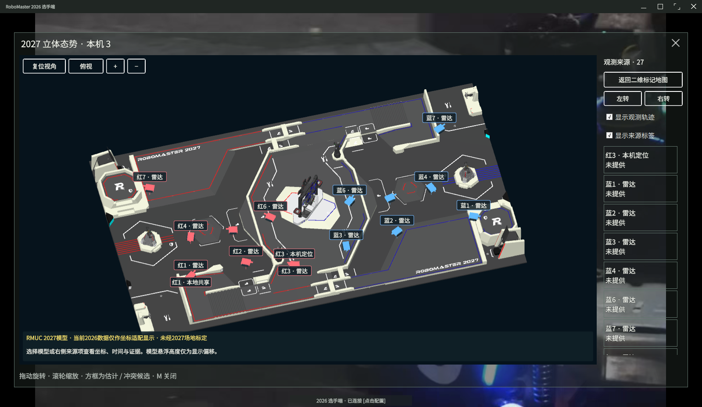
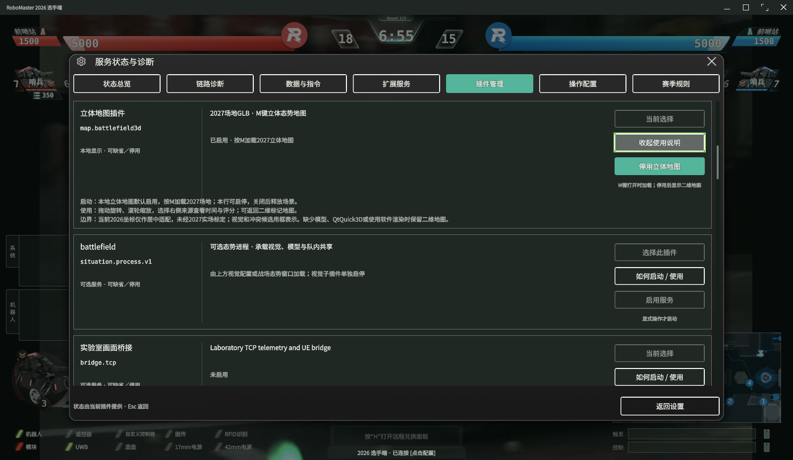
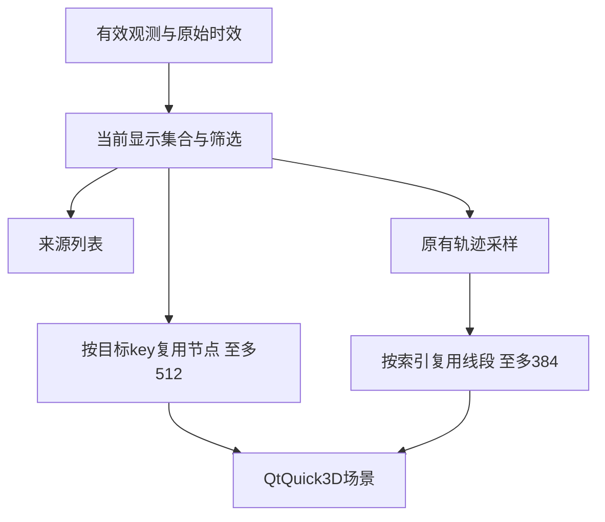
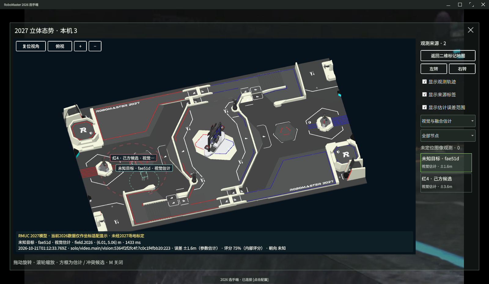
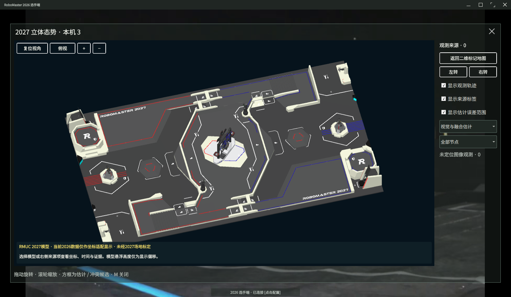

# 战场 3D 视图插件 (map.battlefield3d)

本扩展是面向 RobomasterClient 的可选 QML 目录扩展插件，用于在操作手按下 `M` 键展开大地图时，加载 2027 赛季场地 3D 静态模型（GLB），并在立体空间中直观叠加大地图机器人示意模型、运动方向、采样轨迹与多源感知数据。



## 插件定位与架构说明

- **插件类型**：动态 QML 目录扩展（非 C++ rmplugin 二进制动态库工厂包）。插件入口为 `qml/Field3D.qml`，生命周期由宿主 `OperatorMap3DSlot.qml` 中的 QML `Loader` 驱动。
- **核心解耦**：宿主客户端核心不显式链接 `QtQuick3D`，使普通MQTT、UDP与QML壳层在缺少三维模块时仍可启动。所有 3D 渲染组件封装在扩展目录内，采用 `QtQuick3D View3D`。静态场地可由当前 Qt SDK 的 Balsam 预处理后交给 `Loader3D` 异步载入；资源不完整、版本不匹配或工具不可用时，沿用 `AssetUtils.RuntimeLoader` 的 GLB 路径。机器人示意模型继续使用 GLB。
- **网络与鉴权**：插件本身为纯只读展示层，**不打开任何网络 Socket**，不发送任何比赛控制指令，也不重新实现身份认证。全部数据均沿用宿主既有的 2026 MQTT / UDP 链路与队内传感器插件。

## 场地模型资产信息

- **资产文件**：构建时存在匹配的预处理资源且宿主支持本地资源核对时，优先使用生成的 QML／网格；否则加载 `assets/field-2027-batched.glb`（约 64 MiB），加载失败时回退 `assets/field-2027.glb`（约 37 MiB）。分块版保留 880,181 个放置三角面，按空间区域合并视觉等价的静态材质，减少提交批次；代价是文件及网格缓冲更大。原始模型保留用于兼容回退。
- **来源发布**：基于 [rmuc2027-simplified-glb-20261018](https://github.com/hxyulin/rm-map-tools/releases/tag/rmuc2027-simplified-glb-20261018) 校验构建，衍生自官方 CAD 的简化静态模型，包含 880,181 个放置三角面（非精密施工 CAD）。原始版保留层级结构和根坐标变换，分块版将静态变换烘焙到顶点。几何与外观权利归属及使用条件见 [CAD-NOTICE.md](assets/CAD-NOTICE.md)；工具仓库许可证不替代原始场地素材的权利说明。
- **模型几何范围**：底板外边缘几何范围约 28m × 16.003m（基于图纸边缘，不宣称比赛有效场地精确尺寸）。中心 Y-up 坐标系。在 QtQuick3D 载入时单位乘 100（米换算），并绕 Y 轴旋转 180° 使红方阵营在视图左侧。

## 坐标适配与感知数据叠加规则

1. **2026 遥测数据适配**：当前主链路 2026 数据范围为 28m × 15m，在 3D 场景中保持米制比例居中摆放，界面明确标明为 `2026坐标适配到2027模型、未场地标定`，不把它标成2027官方协议数据。
2. **自定义 2027 约定**：`field.2027` 为本查看器定义的平面坐标约定（左下角原点 (0,0)，长宽 28m × 16m），必须由上游数据生产者自行标定与发布，不是官方 2027 最终网络协议。
3. **多坐标系隔离**：融合输入支持接收 `field.2026` 与 `field.2027`，但不同坐标系的数据**绝对不互相交叉合并**。
4. **冲突与异常处理**：同 ID 且同坐标系来源若空间间距相差 > 2m，视图直接绘制黄色多个冲突候选标记，不伪造平均胜出者；超时数据自动清退；未知阵营或未知 ID 保持未知显示；未提供朝向时不绘制方向箭头；机器人标记设置了约 95cm 的视觉悬浮偏移，仅为避免被地面遮挡的显示偏移，不代表实体真实离地高度；不推断血条与等级。
5. **视觉与雷达标签**：官方雷达未提供置信度时显示 `未提供`，系统内部可用评分标为 `内部评分`，不捏造虚假概率。UDP 链路的 YOLO 检测默认关闭；视觉地面估计需要明确的相机参数、同期本车位姿与必要云台角度；未知身份可以作为匿名候选显示，并保留误差范围，不跨节点臆测身份。缺少定位条件的画面框只计数，不推定地面位置。

## 机器人显示素材

步兵、英雄、工程、空中和哨兵使用原创 glTF 2.0 示意模型，每个兵种有红、蓝及中性色变体，来源与包围盒见 `assets/robot/roles-source.json`。沿用现有 2026 身份编号，不代表未发布的 2027 角色协议。工程使用机械臂外形，空中使用静态旋翼；外形不表示机构正在动作。未知朝向用无方向符号，视觉、融合及冲突候选继续用线框。

采用 GLB 是为了兼容现有 Qt RuntimeLoader，避免绑定某一 Qt 版本的二进制网格格式。每种模型合并为三个材质节点，降低小部件分别提交的成本；代价是不能独立驱动炮管、轮子或旋翼。若以后需要机构动画，应保留骨架或独立节点并重新评估批次。这里没有推理权重，也不参与识别。

## 移动视觉来源与误差显示

地面视觉观测通过已有态势链路进入地图，无需在接收端启动 YOLO。右侧可按类型和节点筛选；未知阵营与编号保持未知，虚线足迹显示参数误差估计，选中目标可查看 UTC 时间、来源、参考系和内部评分。图像框没有有效地面定位时只显示未定位数量；未知目标不跨节点合并。被筛选节点离线后保留筛选选择并提示无新鲜数据，不自动切换为全部节点。配置方法见 [视觉插件说明](../yolo-vision/README.md)。

## 配置与构建部署

### 构建开关
通过 CMake 开关控制是否部署该目录扩展：
```bash
cmake --preset debug -DROBOMASTER_BUILD_3D_MAP=ON
cmake --build --preset debug
```
`ROBOMASTER_PREPARE_3D_ASSETS` 默认开启：本机 SDK 带有 Balsam 且不是交叉编译时，在构建目录生成当前 SDK 对应的 QML／网格资源。没有工具时照常使用 GLB；可设置 `-DROBOMASTER_PREPARE_3D_ASSETS=OFF` 明确关闭预处理。

采用构建时预处理，是为了把固定场地的解析与转换移出首次展开地图的过程。源 GLB 继续保留，生成的网格不纳入源码版本管理，也不作为跨 Qt 版本的通用素材。代价是增加一次构建工作和约 58 MiB 的生成资源；索引会核对实际 Qt 运行库版本、资源位置及文件大小，失败时回退。旧缓存保留，安装只包含当前缓存，常规构建不依赖 ProjectSupport 工具。

保留纯运行时 GLB 的好处是可直接替换模型、无需资产工具；固定地图采用它会保留首次解析成本。直接分发某一版本的私有网格较简单，但不能据此保证其它 Qt 版本兼容，因此没有采用。

若设置 `ROBOMASTER_BUILD_3D_MAP=OFF`，本次构建安装不再部署此扩展。运行目录缺少扩展时回退二维地图；已有构建目录可能保留旧副本，可用界面开关立即停用。

### 运行时配置
插件在 Qt Settings 中注册唯一的本地开关：
- **存储路径**：`OptionalPlugins/Battlefield3D/enabledMap`
- **类型**：`bool`，默认值 `true`
- **含义**：表示操作手按下 `M` 键时是否尝试启动 3D 场景。**注意：enabled 仅代表本地展示意图，绝不表示网络后端已连接**。
- **切换方式**：赛中随时可通过快捷键 `Ctrl+Shift+E` 在插件管理列表中开启或停用。该操作为纯本地展示开关，与网络状态机及模型推断锁无关。停用后按下 `M` 键立即可见二维地图。



## 操作指引与回退机制

- **交互操作**：鼠标左键拖动旋转、右键拖动平移，滚轮以指针位置缩放，`+`/`−` 按钮按中心缩放；“适应窗口”按当前朝向显示完整场地，“聚焦目标”放大选中观测。界面还提供复位、俯视和每次左／右转 15° 的按钮。在右侧列表选中具体来源或在场景中选中机器人模型后，底部栏显示其观测年龄、来源通道与内部评分，超长信息支持悬停查看。选中目标的标签通过细指引线与模型关联，该线不表示运动轨迹，且限制在地图内容区内。
- **生命周期机制**：按 `M` 或 `Esc` 关闭大地图后，隐藏场景停止更新，最多保留 30 秒以减少快速重开时的加载等待；重开立即刷新观测。闲置超时或停用插件时，先停用预处理场地子树并清空场地及机器人 `RuntimeLoader.source`，再卸载场景。Qt 6.11.1 的资源载入路径在 `source` 改变时注销网格引用，因此使用公开属性完成释放，不依赖 Qt 私有接口。该缓存占用内存；清空引用不保证 Qt／驱动立即归还全部内存或显存，核心视频与遥测仍由宿主管理。
- **降级回退机制**：若系统检测为软件渲染环境（`GraphicsInfo.Software`）、缺失 QtQuick3D 运行时库、插件目录或两份场地模型均缺失，`OperatorMap3DSlot` 会自动展示二维地图，并在状态栏给出相应提示。启动客户端时应采用 `--renderer auto` 或 `--renderer opengl`，`--renderer software` 会使用二维回退。
- **资产替换规范**：场地可使用 Blender 编辑，导出时须遵循 glTF 2.0、米制单位和中心 Y-up。当前默认输入为 `assets/field-2027-batched.glb`；修改场地时须同步更新分块版与兼容原版 `assets/field-2027.glb`，再重新配置、构建以刷新预处理资源。只替换原版不会改变正常加载路径。当前原创机器人素材使用独立便携版 Blender 4.5.9 制作，生成器位于项目外的 ProjectSupport 工具目录。更多技术论证见 [TECHNICAL.md](../../docs/TECHNICAL.md)。

配置文档交付要求见 [统一契约](../../plugins/CONFIGURATION_CONTRACT.md)。本扩展无需独立网络地址、模型推理权重或认证密钥；相关通信配置由既有态势插件管理。


## 三维动态节点复用

### 1. 背景与问题定义
在原有实现中，三维战场轨迹渲染由 `Repeater3D.model` 直接绑定至前端每 250ms 重新构建的 JavaScript 数组，动态目标则根据其标识键（key）执行频繁的添加与移除。该机制导致对应的 3D 节点及其材质被周期性销毁与重复构建，增加运行时对象周转。需要明确的是，本次未量化该周转对总内存或帧率的影响，也不能据此断言此前测试中观察到的 44 MiB 内存增长已被定位为内存泄漏。

### 2. 技术方案与对象池实现
为保持架构稳定性，当前方案延续现有的 Qt/QML 技术栈，在 `extensions/battlefield-3d/qml/RenderPool.js` 中实现基于 `ListModel` 角色更新的 3D 节点复用池。新实现依赖长期稳定的成熟 API（`ListModel`、`Repeater3D` 及 `objectAt`），不采用 Qt 6.10 引入的 `delegateModelAccess`。



* **容量与高水位增长**：Marker 节点池上限设为 512，Trail 轨迹节点池上限设为 384。池容量不进行预先全量分配，而是随实际业务并发量动态增长至高水位并维持已达到的槽位。
* **目标槽位生命周期（Marker）**：动态目标依 key 占用对应槽位；目标不再属于当前显示集合（例如过期或被筛选）时，槽位属性置为 `occupied = false` 且 `payload = {}`，同时置为不可见并禁用射线拾取（picking）。释放后的空闲槽位保留在内存中，供后续新到达的 key 复用。
* **轨迹线段生命周期（Trail）**：轨迹线段按索引顺序复用现有节点，避免折线更新时的批量重建。
* **线框与棱边优化**：三维边框棱边（8条）在目标首次激活且确有绘制需要时才延迟实例化，随后常驻复用，仅通过显示状态控制其可见性。
* **交互选择校验**：选中状态判定严格限制在当前有效活跃目标集（`currentRows`）中的 key。若选中的目标过期或失效，关联的选择态立即置空。

### 3. 架构分层边界与权衡
* **展示层边界隔离**：动态节点复用池完全隶属于视图渲染层。节点复用逻辑不介入也不改变底层目标识别、来源 TTL、空间坐标解算、置信度评估、网络数据字段、鉴权机制以及多源融合算法。
* **来源列表对齐**：右侧来源列表依然独立消费底层有效的当前观测数据；池内部的空闲或未占用槽位严禁泄露至业务逻辑层，更不得显示为数据来源或有效目标。
* **生命周期清理**：大地图关闭后先暂停更新并保留最多 30 秒；缓存超时或停用插件后，清空运行时模型来源并卸载整个渲染池。但需注意，Qt 运行时和底层图形驱动仍可能在驱动层保留特定的内部缓存。
* **成本收益与替代方案**：
  * *收益与成本*：核心收益在于规避了轨迹与目标密集更新时节点与 GPU 材质对象的反复创建与析构；主要成本在于地图保持打开期间，系统需在内存中维持已达到的高水位槽位及生成的棱边实体。
  * *每帧销毁重建*：逻辑实现直接，但会重复构建对象；本次没有测量它造成的帧率变化。
  * *QtQuick3D GPU Instancing*：理论上支持更高密度的实例化，但本次未开展性能对照评估。由于其需要针对异构几何体、多状态显示、独立射线拾取及身份映射进行底层重构，需要额外实现与维护；当前先使用已有模型角色接口，不迁移至 Unreal Engine。

### 4. 诊断指标与验证状态
为监控复用池内部健康度，模块内置了诊断计数链路：
* **监控项**：包含 `markers/trails active`（当前活跃数）、`slots`（当前已分配槽位数）、`objectAdded` 累计计数以及实际 `Node.visible` 标志计数（不代表未被场地或视锥遮挡）。
* **空闲槽约束**：空闲槽位必须清空载荷数据（`payload = {}`），严禁残留上一生命周期的历史记录。
* **UI 隔离**：上述指标仅供内部调试与性能诊断使用，不在面向用户的普通操作界面呈现。

**测试执行进展**：
* **已通过项目**：已完成 8 项地图数据用例与 4 项槽位契约用例测试，结合 Qt 测试框架的前后初始化与清理，累计记录 16 项 PASS 事件。
* **原生检查通过**：Qt 6.11.1、Linux、RTX4060 Laptop/OpenGL 环境下，960×570、1600×930、2400×1380 地图检查完成。按 300 秒目标运行，299 份样本覆盖 299.84 秒，新增视频解码 8,554 帧、视觉推理 979 帧；每份样本均核对实际节点可见数、空槽无旧记录和创建计数。300 秒采样阶段仅创建 30 个目标节点与 6 个轨迹节点。随后通过实际轨迹开关、视觉来源停止后的撤回与选择清空、M 关闭卸载及重新打开检查。
* **实测边界**：尚不能据此判断总内存下降比例、吞吐量或帧率变化，也不能声明不存在泄漏或身份判断正确。

### 5. 本次资源样本与边界
同一 i7-12800HX、Linux 6.8.0-138 主机，1600×930 窗口、CPU 双模型、身份阈值 0.7／连续 4 帧时，Qt 主进程样本最大 RSS 为 1,329,848KiB，前后 30 样本中位数分别为 1,283,616KiB 和 1,292,406KiB；辅助进程最大为 276,684KiB，前后中位数为 276,544KiB 和 276,684KiB。数值包括整个进程，不是显示插件增量。Qt 仍有增长；与前一轮窗口和面板操作历史不同，没有严格配对对照，因此不报告内存改善百分比，也不能判断泄漏已排除。录像与相机／本车位姿配置仍是已标明的集成假设。

角色更新接口见以下官方资料。当前模型使用动态角色承载观测对象，其转换仍有成本；本次未测量总 CPU 或帧率变化。

* Qt Quick 3D Repeater3D QML Type: [https://doc.qt.io/qt-6/qml-qtquick3d-repeater3d.html](https://doc.qt.io/qt-6/qml-qtquick3d-repeater3d.html)
* Qt Quick ListModel QML Type: [https://doc.qt.io/qt-6/qml-qtqml-models-listmodel.html](https://doc.qt.io/qt-6/qml-qtqml-models-listmodel.html)


三端原生检查也已通过：两端运行整机与装甲辅助识别，第三端关闭 YOLO，三个地图均收到两个视觉来源。每端均检查创建数与槽位数一致、空槽没有旧记录；一个来源退出后，其观测从另一端地图撤回，其余来源继续显示。





以上为单个原生窗口的实际画面，采用公开录像和明确标识的相机／本车参数假设，不能证明实车测距或身份准确率。来源停止后空槽保留以便复用，界面不显示其旧记录；地图关闭后最多缓存 30 秒，缓存超时或停用插件时才卸载整个场景。
