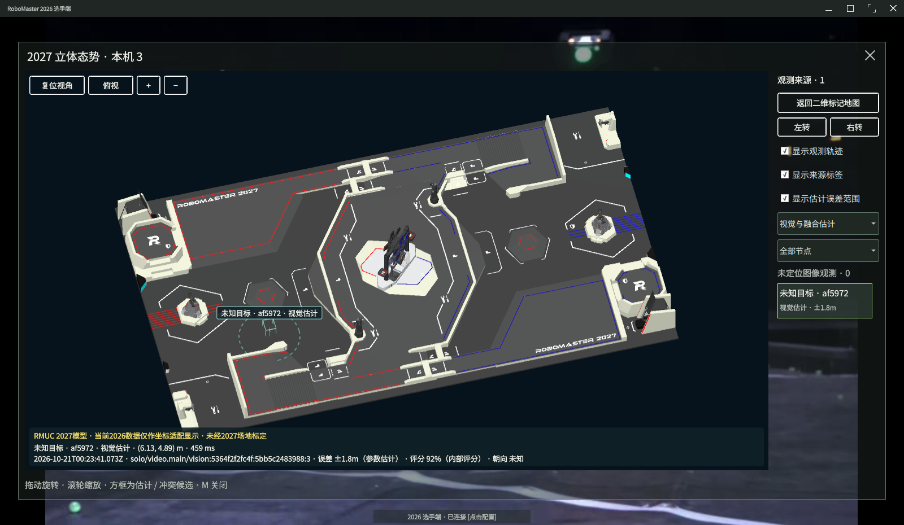
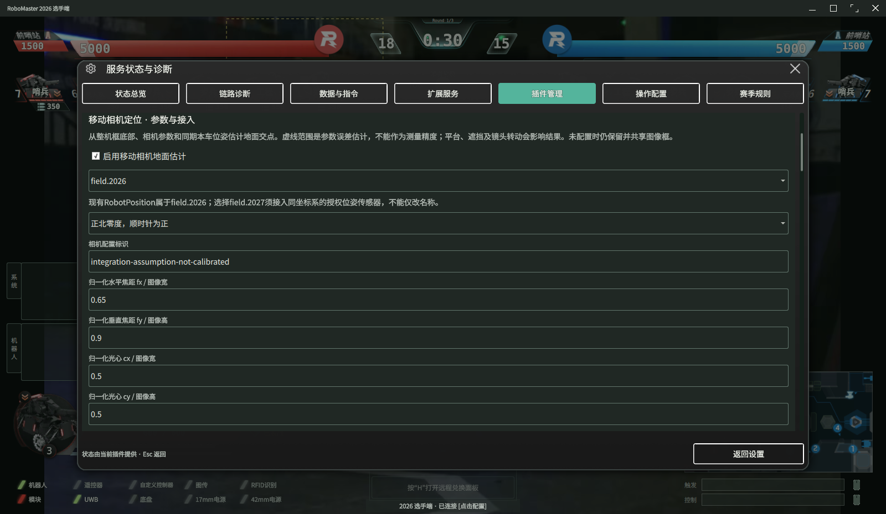
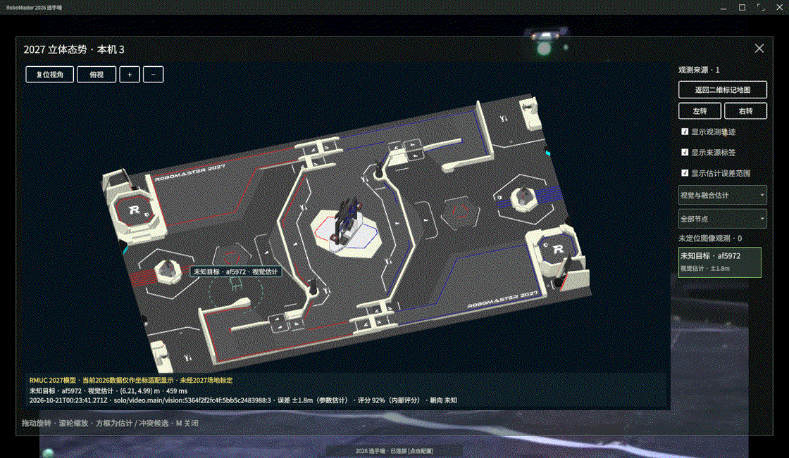
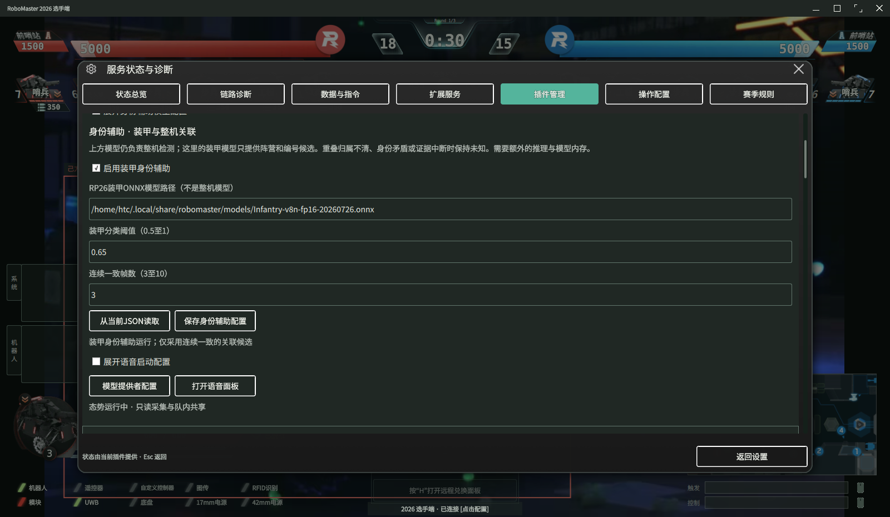
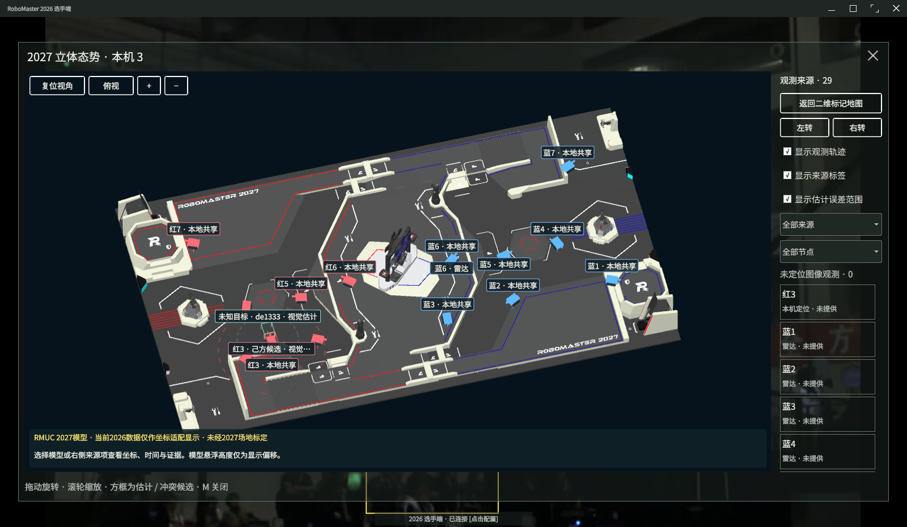

# 本地 YOLO 视觉检测扩展插件 (extensions/yolo-vision)

## 插件清单与架构定位
本目录包含基于 ONNX Runtime的本地目标检测可选插件：
- `vision.yolo.onnx`：由态势协调器管理的独立计算进程（`runtime/worker.py`）承载的推断模块（非独立原生插件工厂），角色为 `vision`。

**核心架构与生命周期约束**：
1. **默认关闭与阶段锁**：YOLO 视觉服务默认保持关闭状态，仅在操作员通过界面明确启用时启动。
2. **独立图像进程**：YOLO 与吊射分别运行，私有有界 IPC、心跳及任务超时为 3 秒。仅变更视觉／吊射及共享开关时可独立应用，保留协调器、队内会话与另一工作进程；公共配置改变仍重启协调器。故障只停对应图像任务，显式停启重试。
3. **跨端协同**：接收端本地不需要启用 YOLO 检测，只需配置授权的队内数据通信链路，即可在态势窗口查看对端图像框和观测；地面投影仍需有效标定，队友图像框不会直接叠加到本机相机画面。

## 依赖与启用条件
1. **环境依赖**：依赖机器上自行配置的 Python 环境及第三方包（`numpy`, `opencv-python-headless`, `onnxruntime`）。
2. **模型权重**：**本代码仓库不包含任何模型权重文件**。ONNX 模型必须在宿主机上预先下载或导出，并通过本地绝对路径配置。
3. **启动入口**：按下 `Ctrl+Shift+E` 打开「插件管理」，在视觉插件行填入配置 JSON 后，点击本行的启用按钮启动服务。

## 配置字段说明
配置通过视觉配置 JSON 对象传递，代码支持的字段如下：

| 字段名 | 类型 | 默认值 | 约束与说明 |
| :--- | :--- | :--- | :--- |
| `enabled` | 布尔 | `false` | 视觉检测使能开关 |
| `model_file` | 字符串 | 空 | 必填，指向兼容ONNX模型文件；未启用时不加载 |
| `format` | 字符串 | `"yolo-v5"`（随附模板） | 省略本字段时内部兼容回退为 `rp26-armor-v8`；建议始终明确填写。目标检测方言：`"rp26-armor-v8"`（装甲板识别）或 `"yolo-v5"`（整机识别） |
| `threads` | 整数 | `2` | ONNX Runtime intra-op 线程数，内部限制在 1–4 之间 |
| `confidence` | 浮点数 | `0.55` | 候选目标置信度阈值（0.0–1.0） |
| `labels` | 对象列表 | 见模板五类别 | 按模型索引排列，每项含 `label`、`robot` 及可选 `team`、`target_id` |
| `calibration` | 对象 | `{}` | 保留的固定相机单应矩阵配置，不适用于随底盘或云台运动的相机 |
| `projection` | 对象 | 默认关闭 | 移动相机内参、安装参数、位姿与云台来源；见下节 |

### 模型格式与识别限制说明
- **整机 yolo-v5 五类别机制**：当 `format` 设为 `"yolo-v5"` 时，模型仅关注整车目标。配置中 `car` 与 `watcher` 判定为有效（`true`），而 `armor`、`ignore`、`base` 均视为无效目标（`false`）。
- **阵营与标号限制**：若当前观测无确切阵营与编号特征，目标保持为 `unknown`，绝不凭空推断。
- **吊射辅助边界**：吊射检测仅捕获运动像素拖影与高亮候选点，并不具备稳定的弹丸分类器或真实空气动力学弹道解算能力；UI 上显示的紫色虚线仅为 150 毫秒的时间窗口图像外推，请勿夸大其实时性与测距精度。

## 最小配置与使用示例
先复制 `../battlefield/config/default.json` 为本机配置文件，将顶层 `python` 改为已安装依赖的解释器绝对路径，再修改其中 `vision` 节点。下列仅为该节点片段，不能单独作为完整配置文件：

```json
{
  "enabled": true,
  "model_file": "/absolute/path/to/robot.onnx",
  "format": "yolo-v5",
  "threads": 2,
  "confidence": 0.60,
  "labels": [
    {"label":"car","robot":true,"team":"unknown","target_id":"unknown"},
    {"label":"armor","robot":false},
    {"label":"ignore","robot":false},
    {"label":"watcher","robot":true,"team":"unknown","target_id":"unknown"},
    {"label":"base","robot":false}
  ]
}
```

**使用与状态判断**：
在视觉配置输入框填写完整JSON文件路径，并核对ONNX路径，再点击YOLO行「启用服务」。更换模型时标签顺序必须与实际输出一致，不能直接套用五类别模板。观察插件状态输出：
- 状态文本显示为「`整机识别跟踪中；阵营与编号以实际识别依据为准`」（或 `rp26-armor-v8` 模式下的「`装甲识别跟踪中；装甲框不代表整机`」）。
- 检查 `frames` 帧计数递增，`inference_ms` 表示实际推理耗时；当前文档不规定未经实测的帧率或延迟保证。
- 未经标定时，坐标边界为 `image observations; optional explicitly configured mobile ground estimate`。

## 移动相机定位的配置与保存

- **配置入口**：快捷键 `Ctrl+Shift+E` -> 点击“插件管理” -> 展开“移动相机定位配置”。参数编辑沿用宿主阶段锁：已确认的准备、自检、倒计时或结算阶段（0、1、2、5），或断开且未选择身份时允许保存；比赛进行中和阶段不明时禁止保存。
- **存储路径与权限**：配置原生保存至操作系统的 `AppConfigLocation/vision-projection.json`，权限强制设为 `0600`，原配置文件保持原样；程序另外保存一份完整配置副本，不创建原文件的额外备份。
- **生效机制**：保存配置不会自动启动 YOLO 或激活投影计算，必须显式点击“应用视觉 / 队内通信配置”；YOLO 原先未启动时，还需在插件行点击启用。

## 完整文件与投影参数

`vision-projection.json` 是完整 `rm.situation.config/1` 配置副本，其中 `vision.projection` 才是局部定位参数；不能将局部对象单独作为运行配置。保存时保留节点、通信、权限和其它插件设置，并写入界面中填写的有效 ONNX 路径。部分高级字段仍需编辑完整 JSON，界面保存会保留这些字段。

| 参数 | 含义与默认边界 |
|---|---|
| `normalized_intrinsics` | `[fx/W, fy/H, cx/W, cy/H]`，须对应当前解码图像；可用 `distortion` 提供 OpenCV 的 4、5 或 8 项畸变参数 |
| `camera_height_m`、`pitch_down_deg` | 相机相对目标地面的高度与安装俯角，向下为正；不能直接套用示例值 |
| `camera_yaw_offset_deg`、`roll_clockwise_deg` | 相机安装偏航与滚转，顺时针为正；平移可在 JSON 中设置 `forward_offset_m`、`right_offset_m` |
| `pose_heading_clockwise` | 明确确认 RobotPosition 北向零度的角度正方向；该航向不是云台角度 |
| `frame_id`、`calibration_id` | 参考系及可追溯的参数标识；启用时参考系必须与完整配置一致 |
| `rigid_camera_confirmed` | 仅相机确实固定在底盘上时可确认；活动云台必须接入实时角度 |
| `gimbal_node_id`、`gimbal_source_id`、`gimbal_target_id` | 选择已授权的云台传感器，默认目标 `camera.main`；`odometry` 观测使用 `robot.body`、单位 `deg`、向量 `[顺时针偏航, 向下俯仰, 顺时针滚转]` |
| `pose_node_id`、`pose_source_id`、`pose_target_id` | 可选的已授权外部里程计位置及 `heading_rad`（世界 X 轴起算、逆时针为正）；指定后不回退至其它来源 |
| `pose_max_age_ms`、`max_range_m`、`max_uncertainty_m` | 默认 1100ms、25m、8m，可在完整 JSON 中调整 |

默认 `field.2026` 接收现有 RobotPosition。若使用 `field.2027`，需接入确实在该参考系下标定的位姿来源，并同步完整配置和队友授权；程序不会通过改字段名把 2026 雷达或本车数据变成 2027 数据。`field.2027` 仍是查看器约定，非官方最终协议。

## 为什么采用移动相机几何投影

移动相机不能沿用同一固定 H 矩阵表示不断变化的底盘和云台姿态。本实现利用相机内参、安装高度、同期位姿和角度计算地面交点，不额外加载深度网络，便于核对几何依据与失效条件。旧的固定相机 H 路径仍保留；启用移动投影后，不会静默回退至旧 H。

代价是依赖相机标定和地面假设：目标在坡面、高台或脚部遮挡时可能出现系统偏差。未引入单目深度、双目或已知装甲尺寸 PnP；这些替代方法需要相应权重、尺度约束、硬件或角点质量，本项目没有做精度与性能对照。针孔和畸变模型依据见 [OpenCV 标定文档](https://docs.opencv.org/4.x/d9/d0c/group__calib3d.html)。

## 失效条件与未知目标

- **投影前提**：只对整机检测框底边中心作地面接触假设；装甲板框拒绝投影。整机框底边也不保证是真实接地点，遮挡误差仍须人工识别。
- **降级为纯图像观测**：当遇到视线接近地平线、脚部边界截断、坐标系不兼容、位姿/云台数据超时（>1100ms）、误差估计超限（>8m）或超出视距（>25m）时，系统自动降级为纯图像观测，不生成世界坐标。
- **目标标识一致性**：未识别阵营与编号的目标统一保留为未知状态，分配 `node+session-local` 临时标识，**严禁凭推断伪造敌方身份、阵营或战车编号**。

三维地图将有效估计绘制为线框候选与可开关的虚线误差足迹，并显示来源、UTC 时间、参考系和内部评分。该范围是参数敏感度与时间偏差的启发式估计，不是经标定的概率置信区间。界面可按节点或来源类型筛选；未定位图像框单独计数，过期后撤回。未知目标按节点与会话分配临时标识，不将不同观察者的未知框误合并为一辆车。

## 当前验收范围

Qt/C++ 生产构建、13 项几何与管线测试、3 项序号历史测试、25 项定向回归及 8 项地图数据用例通过。原生三端验收中，两端使用各自的实际 UDP 视频输入和整机 ONNX，第三端关闭 YOLO；三个地图均接收到两路视觉观测。另已检查授权云台角度、配置完整副本与权限、断连撤回，以及停止辅助进程后主视频与 MQTT 继续更新。







上述画面采用公开录像和明确标识的相机、位姿集成假设，验证的是实际识别、计算、共享和原生显示链路，不能证明实体测距精度。960×570、1600×930、2400×1380 原生窗口已检查。尚未完成实车内外参标定、长时间资源测量与身份准确率评估；五类别模型本身的未知目标仍保持未知，可选装甲辅助见下节。

### 可选装甲身份辅助

#### 1. 功能定位与设计原则
整机五类别检测模型仅输出机器人类型，不包含红蓝阵营及装甲编号信息；本模块引入外部装甲检测作为分类辅助证据。

- **整机基准不变**：系统始终以整机检测边界框（BBox）和整机底边接地点投影为主体，装甲候选框仅用于提取编号与颜色，**绝不替换**整机目标框。
- **谨慎判定**：装甲识别结果不保证绝对正确，证据不足时立即回退至未知状态。

#### 2. 配置说明
身份辅助模块没有独立常驻服务，其配置为完整配置中的 `vision.identity` 片段。通过快捷键 `Ctrl+Shift+E` 在插件管理中选择完整 JSON，展开“身份辅助模型配置”填写参数，保存后明确应用，再按需启动 YOLO。也可直接编辑完整 JSON；状态在插件管理面板查看。

```json
{
  "vision": {
    "identity": {
      "enabled": false,
      "model_file": "/absolute/path/to/rp26_armor.onnx",
      "confidence": 0.65,
      "minimum_hits": 3
    }
  }
}
```

- `enabled`：是否启用身份辅助，默认 `false`。
- `model_file`：外部 RP26 装甲检测 ONNX 模型的绝对路径。
- `confidence`：装甲检测置信度阈值，默认 `0.65`。
- `minimum_hits`：确认身份所需的最少连续匹配帧数，默认 `3`，可配置范围为 `3..10`。

#### 3. 关联与决策机制
- **串行处理流**：在同一视频解码帧内，先执行整机检测，再执行装甲检测。
- **空间几何门限**：
  - 装甲检测框面积的至少 **85%** 必须落在**唯一**整机框内部。
  - 装甲框面积不得超过对应整机框面积的 **35%**。
  - 若装甲框与多个重叠整机框产生归属歧义，或同一整机框内检测到相互冲突的装甲身份，该整机身份标记为 `unknown`。
- **置信度差值过滤**：装甲类别与颜色的 Top-1 与 Top-2 分数差必须 $\ge 0.15$，防止弱分类引入错误噪声。
- **时序连续性校验**：同一跟踪轨迹（Track）需满足连续 `minimum_hits` 帧产生一致的身份分类，且相邻帧时间间隔不超过 **500 ms**，才会更新为当前候选身份。
- **异常退回与隔离**：
  - 一旦关联证据链中断（包括时序中断、几何脱出或分数不足），整机身份立即恢复为 `unknown`。
  - 严禁跨相机画面臆测或继承身份。
- **协议输出语义**：
  - 沿用现有的 `rm.situation/1` 协议字段发送，接收端在 YOLO 停用时仍可按原协议正常接收其它源数据。
  - 图像 `bbox` 依然保持整机坐标；身份标签注明装甲关联候选，并固定输出 `estimated=true`。
  - 协议中没有独立敌我字段；敌我关系需要比对识别出的红蓝阵营与本车当前所属阵营；当前共享字段保留红蓝与来源，不新增独立敌我字段。界面按本车身份显示“己方候选／敌方候选”，本车或目标阵营未知时不判敌我；`unknown` 状态**不会**自动降级或假设为敌方。

#### 4. 开销与异常处理
- **计算代价**：
  - 每帧增加一次 CPU ONNX 模型推理与额外的模型常驻内存。
  - 整机与装甲模型已复用同一次 JPEG 解码得到的图像，各自的模型预处理与推理仍独立。
  - 模块不提供任何 GPU 加速、帧率下限或检测精度承诺。
- **异常容错**：模型文件缺失或推理错误时，辅助模块退避 5 秒后重试；非法配置直接禁用辅助识别。两种情况都保留整机检测。

#### 5. 验证状态与已知限制
- **已通过自动化验证**：
  - 5 项身份契约测试
  - 13 项几何投影计算测试
  - 3 项序号历史一致性测试
  - 25 项核心功能回归测试
- **当前限制与待办**：
  - **红蓝与编号实测准确率尚未验证**：原生单端双模型视频接入已产生 red:2、red:3、red:4、red:7 候选，但没有标注真值对照，无法提供准确率；原生三端共享已收到同一来源的身份候选、整机框与估算位置，其中接收端关闭 YOLO；断连后观测撤回。
  - **物理标定未就绪**：相机内外参及本车/云台时序仍需实车标定；身份辅助不解决地面测距偏差。

## 身份辅助的界面配置与共享解码



### 1. 界面配置与校验机制

在客户端主界面按下快捷键 `Ctrl+Shift+E` 打开“插件管理”，展开“身份辅助模型配置”面板即可进行参数调整：

* **前置依赖**：配置前必须先在界面中选择完整的态势 JSON 文件。
* **参数项**：
  * **启用开关（enabled）**：勾选仅代表启用身份辅助的“配置意图”，并不代表装甲模型已实际加载成功。
  * **装甲模型路径**：填写 RP26 装甲 ONNX 模型的绝对文件路径（原有整机检测 ONNX 路径仍保留在上方输入框，互不混淆）。
  * **置信度阈值（confidence）**：浮点数范围 `0.5 ~ 1.0`，默认值为 `0.65`。
  * **确认帧数（minimum_hits）**：整数范围 `3 ~ 10`，默认值为 `3`。
* **安全保护与编辑规则**：
  * **阶段锁**：沿用既有赛外编辑安全规则，仅允许在已确认的赛外阶段（`0`、`1`、`2`、`5`）或“未选择身份且处于连接断开”状态下执行保存；处于比赛中或阶段不明时禁止保存。
  * **前端防御**：当输入的阈值或确认帧数超出合法范围时，界面会自动禁用“保存身份辅助配置”按钮。
  * **宿主校验**：保存与应用时，宿主程序会二次核验字段白名单、数值类型与取值范围，并确认模型绝对路径指向的本地文件真实存在。
* **容错隔离**：装甲模型文件缺失或在运行中发生推理异常时，系统仅安全停用身份辅助分支，整机检测逻辑继续正常运行。

### 2. 配置落盘与应用生命周期

点击“保存身份辅助配置”后，系统通过 Qt 的 `QSaveFile` 原子写入机制生成配置文件：

* **存储路径与权限**：配置将以完整副本形式写入 `AppConfigLocation/vision-projection.json`，权限强制设置为 `0600`。该文件与相机配置共用同一路径，保存时会完整保留原始输入文件的其他已有配置小节。
* **生效步骤**：
  1. 点击“保存身份辅助配置”操作**不会**触发后端自动重启，也**不会**自动启动模型推理。
  2. 配置写入后，需显式点击上方的“应用视觉/队内通信配置”。
  3. 最终按需在主界面的 YOLO 控制行中手动启动推理工作流。
* **设计理由**：延续客户端既有的 Qt/QML 表单校验、赛况阶段锁及原子文件写入规范，避免赛场人员手工编辑 JSON 文件带来的格式错误与配置污染，不引入额外的新配置系统或隐式自动化开关。

### 3. 共享解码计算链路

针对整机与装甲双模型串接场景，工作流水线采用内存只读共享机制优化图像处理：

* **单次解码与只读共享**：在同一推理工作线程内，接收到的单帧 JPEG 图像仅执行一次解码操作。解码生成的 `numpy` BGR 图像由两个消费者只读使用，分别传递给整机检测模型与装甲辅助模型。
* **独立推理分支**：两个模型分支分别独立进行各自所需的 `resize` / `letterbox` 预处理、张量转换与独立 ONNX Runtime Session 前向推理。
* **状态一致性**：输入的原生图像在管道中不进行任何绘制或原地改写，完整保留同一帧的时间戳与空间位姿元数据。
* **无等待队列设计**：管线内部不设立全局帧缓存，也不增加缓冲队列，推理调度依然维持全链路“最多 1 个在途推理任务”，避免积压延迟。
* **诊断计数**：
  * 系统新增 `jpeg_decodes` 诊断统计字段，仅记录工作线程成功解码图像的累计次数。
  * 由于工作线程并发读取及主动丢弃未及处理帧的机制，`jpeg_decodes` 与下游模型完成推理的计数之间在正常运行时可能暂时相差一帧；推理失败、过期丢弃或会话重置也可能产生更大的差距，该数值不代表 UDP 接收到的原始网络包总数。

### 4. 性能预期与当前测试状态

* **收益与物理局限**：
  * **明确收益**：消除双模型场景下同一张图像的重复 JPEG 解码开销，减少重复解码工作；整体 CPU 占用改善尚未做对照测量。
  * **局限性声明**：共享解码不承诺整体推理时延减半，也不提供固定帧率保证；引入装甲辅助模型所带来的第二模型前向计算开销及内存占用仍然客观存在。
* **测试与验证进展**：
  * **已通过**：共 23 项针对性自动化测试（13 项坐标投影映射测试、3 项防重放序号历史测试、5 项身份关联测试、2 项共享解码逻辑测试），Qt 生产环境构建编译通过。
  * **原生验收已完成**：960×570、1600×930、2400×1380 表单可用；实际鼠标与键盘操作验证非法阈值禁用、赛中保存拒绝、完整副本及权限保留。保存不重启；明确应用后，身份确认参数才更新为测试设置的 0.7 阈值、连续 4 帧。连续运行按 300 秒目标执行，299 份样本覆盖 299.76 秒，新增 UDP 解码视频 8,554 帧、完成视觉推理 990 帧，全程保持 MQTT 连接，结束时三维地图仍可用。该输入是公开录像与已说明的相机/本车位姿集成假设，不是实体场地测距验收。


同一台 i7-12800HX、Linux 6.8.0-138、Qt 6.11.1 主机，使用 CPU 双模型、1600×930 三维窗口时，本次内存记录如下。数值包括整个进程，不是插件增量；未做关闭共享解码的同工况对照，不能据此报告性能提升比例。

| 进程 | 样本最大 RSS | 前30样本中位数 | 后30样本中位数 |
|---|---:|---:|---:|
| Qt 客户端 | 1,347,204KiB | 1,295,190KiB | 1,339,616KiB |
| 辅助计算进程 | 272,872KiB | 272,836KiB | 272,868KiB |

Qt 内存中位数有所上升，期间存在回落；本次未区分渲染缓存、分配器留存与潜在泄漏，不能作无泄漏结论，也不替代数小时运行检查。



## 停用、缺失与异常处理
- **权重文件或环境缺失**：若未安装 `onnxruntime` 或模型文件损坏，进程日志记录初始化失败，不产生有效检测；查看态势宿主的具体初始化错误。
- **停用与重载**：在插件管理取消本插件勾选，`battlefield` 进程平稳退出，主视频显示不受影响，原叠加的识别框立即清除。

关于战场推断进程 IPC 规范与坐标归一化，请参阅 [TECHNICAL.md](../../docs/TECHNICAL.md)。

## 配置文档交付约定
本说明随源码与分发物交付。若制作 `rmplugin.json` 扩展包，将 `README.md` 列入 `robomaster_package_extension(... FILES ...)`。现有清单不新增 `documentation` 键；缺少说明的旧包仍可加载。统一要求见项目技术手册第 8 章。

## 目标范围与故障边界

`vision.filter.mode` 默认 `enemy_and_unknown`：隐藏已确认己方，未知阵营保持未知；`all` 显示并共享全部候选。此设置过滤本机框和发送观测，不减少全图模型计算，不改变雷达。插件管理中选择范围后先“保存目标范围”，再“应用视觉／队内通信配置”；保存完整私有副本，不修改原文件，也不自动启动模型。

整机与身份模型共享同一 JPEG 解码后的完整 BGR 图像，各自预处理，并未实现 ROI 裁剪推理。单独停启保留观测序号，对端无需重置防重放会话。图像进程不继承模型密钥或队内令牌，但仍以相同用户运行，不是权限或资源沙箱。三端共享、三维地图、强杀隔离和无可选插件回退结果见[插件隔离与验收](../../docs/TECHNICAL.md#plugin-isolation)。
